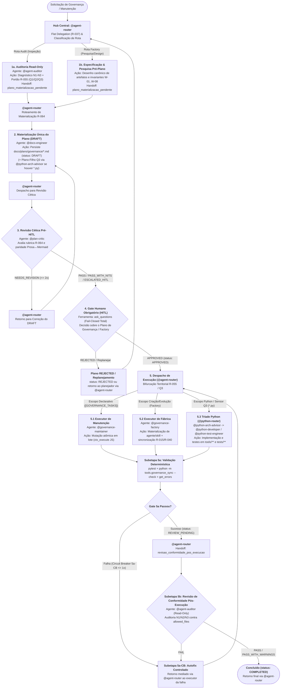

> **Fonte de verdade operacional:** [`CLAUDE.md`](../../../CLAUDE.md) § R-050, R-041 e R-042.  
> **Índice completo:** [`.github/agents/workflows.md`](../workflows.md).

---

### 3.5 WORKFLOW 5: `WORKFLOW-GOVERNANCE-MAINTENANCE` (Governança e Manutenção do Ecossistema)

- **Objetivo**: Auditar, padronizar, expandir e manter o catálogo de agents, skills, prompts e convenções do repositório de governança com Pesquisa Prévia de Mercado compulsória (via `@deep-search`), checkpoints humanos para mutações estruturais, execução atômica em lote (R-046) com Sincronização Quádrupla SSOT (R-015) e validação final via Quality Gate de Governança (Tier 1) e suíte determinística de testes (`implementation_plan_authoring` quando houver escopo Python/Q3).
- **Gatilhos de Fast-Path**: `"auditar governança"`, `"novo agent"`, `"nova skill"`, `"novo prompt"`, `"nova stack"`, `"manutenção de catálogo"`, `"corrigir smell de agent"`, `"higiene de repositório"`.
- **Política R-041**: **Bypass Total** de `@prompt-structuring`. Direcionamento imediato para auditoria ou factory.



#### Cadeia Sequencial e Papéis:
- **Portão de Reúso e Generalização Sistêmica (R-055 — Prioritário & Mandatório)**: Toda demanda de manutenção, revisão, novo padrão ou correção técnica que envolva agents, prompts ou skills DEVE obrigatoriamente responder às 3 perguntas de generalização antes de codificar, eliminando o anti-padrão de correções em silo (*one-off fixes*):
  - **Q1 (Impacto Horizontal / Peers)**: *Esta melhoria ou correção se aplica a outros artefatos do mesmo perfil, camada ou família (ex.: outros routers, outros testers, outros advisors)?* Se sim, expandir compulsoriamente o escopo em lote único (*Single-Turn Batching*, R-046) para cobrir todos os artefatos análogos na mesma entrega.
  - **Q2 (Prevenção Futura / Templates)**: *O template canônico em `templates/` (`router-agent.md`, `operational-agent.md`, etc.) reflete essa nova exigência?* Se não, o template correspondente DEVE ser atualizado na mesma entrega para que futuros artefatos gerados pelo `@governance-factory` já nasçam em conformidade.
  - **Q3 (Blindagem por Teste / Quality Gate — Regra de Fronteira Híbrida com Tríade Python)**: *A suíte determinística em `tests/governance_audit/` já valida essa regra?* Se não, o requisito de teste DEVE ser especificado no plano de governança e delegado via handoff ao `@python-router` (visto que o `@governance-maintainer` possui veto Fail-Closed contra editar `*.py`, `conftest.py`, `pyproject.toml` ou rodar `pytest`), que aciona **1º `@python-arch-advisor`** (elabora o Plano de Implementação e Testes em `docs/plans/implementation/` vinculado via `related-planning-doc`) e **2º `@python-developer` / `@python-test-engineer`** (implementam código/testes em `tools/**/*.py`, `scripts/**/*.py`, `tests/**/*.py` e executam `pytest`).
- **Protocolo de Avaliação de Pertinência de Importação de Skills (R-067 — Prioritário em Pedidos de Importação Externa)**: Toda solicitação de importação de skill externa aciona compulsoriamente, no Estado 1, a avaliação de pertinência do `@governance-factory` (domínio, duplicidade, aderência estrutural e guardrails R-031/R-038) ANTES de qualquer pesquisa de mercado ou materialização de arquivo. Resultado não pertinente → reporta impacto negativo e aguarda orientação via `ask_questions`; conceito útil mas importação literal inadequada → propõe solução alternativa (retrofit em skill existente, adaptação, modularização).
1. **Estado 1 — Diagnóstico Read-Only ou Pesquisa Prévia**:
   - *Diagnóstico de Smells & Reúso*: O `@agent-auditor` executa auditoria estática e comportamental contra os smells canônicos de governança e avalia compulsoriamente Q1, Q2 e Q3.
   - *Auditoria de Higiene & Documentação*: O `@repo-hygiene-auditor` audita a saúde do repositório, licença e segurança de versionamento; o `@docs-engineer` mapeia a integridade documental, alinhamento técnico de manuais e conformidade de guias de governança.
   - *Pesquisa Prévia Compulsória (Criação de Artefatos / Stack)*: O `@governance-factory` delega compulsoriamente ao `@deep-search` a investigação de mercado antes de escrever novos prompts, skills ou agents.
2. **Estado 2 — Materialização Física do Plano R-064 em `docs/plans/governance/` (`status: DRAFT`) & Revisão Cética Pré-HITL (`@plan-critic` — § 10.7)**:
   - *Autoria e Persistência Pré-Checkpoint*: O `@agent-auditor` estrutura o plano (`plan_type: "governance"`) e aciona `@docs-engineer` (ou `@governance-maintainer`) para materializá-lo fisicamente em `docs/plans/governance/<AAAAMMDD-HHMMSS>-governance-maintenance-<slug>.md` com `status: "DRAFT"` e `approved: false`.
   - *Revisão Cética Pré-HITL Obrigatória (`@plan-critic` — Two-Tier Hybrid Gate, ref. `invariantes-e-protocolos.md § 10.7`)*: Antes de acionar `ask_questions`, o plano `DRAFT` é submetido obrigatoriamente ao `@plan-critic` (Tier 1 determinístico + Tier 2 cético Read-Only sob Context Firewall, máx. 2 rodadas), que valida a completude de `allowed_files`, a matriz R-055 (Q1/Q2/Q3) e a estratégia de rollback.
3. **Estado 3 — Checkpoint Humano R-064 (`ask_questions` sobre `plan_ref`)**:
   - Somente após veredito `PASS` ou `PASS_WITH_WARNINGS` do `@plan-critic` (ou `ESCALATED_HITL` após `max_critic_rounds = 2`), toda manutenção estrutural ou criação de stack exige aprovação humana explícita via `ask_questions` referenciando o `plan_ref` já gravado em `docs/plans/governance/` antes de qualquer mutação na malha (modo **Fail-Closed**).
4. **Estado 4 — Execução e Sincronização em Lote por Tipo de Artefato (R-015 / R-046 — requires_plan: true)**:
   - O `@governance-maintainer` aplica as alterações declarativas (`.github/**` exceto `*.py`, `CLAUDE.md`, `README.md`, `CHANGELOG.md`) em lote único (*Single-Turn Batching*) utilizando o `context-mode` MCP no sandbox para múltiplos arquivos, promovendo o plano em `docs/plans/governance/` para `status: "APPROVED"` e `approved: true`. Quando houver criação/atualização de testes Python (`tests/governance_audit/**/*.py`), a execução é particionada em Onda 4B via handoff para `@python-router` → `@python-arch-advisor` → `@python-test-engineer`.
   - **Sincronização Atômica por Tipo (R-015 — gap corrigido)**: o conjunto de arquivos sincronizados depende do tipo de artefato, nunca uma lista fixa de 4 arquivos:
     - **Novo Agent**: `catalog.yaml` + `routing-graph.yaml` (nós/arestas) + **novo caso em `.github/agents/evals/casos-roteamento.yaml`** (exigência formal de R-040) + `agent-router.agent.md` (Decision Tree, se rota primária) + `README.md`.
     - **Nova Skill**: `.github/skills/.index.json` + `.github/skills/README.md` + `source_docs:` dos agents consumidores.
     - **Novo Prompt**: `.github/prompts/README.md`.
     - **Nova Stack**: todos os itens acima aplicados ao sub-catálogo de domínio (`*-catalog.yaml`) + domain router correspondente.
     - **Workflow**: validar as 8 Invariantes de Origem em `.github/skills/governance-factory-patterns/references/workflow-invariants.md` e paridade quádrupla (`workflows.md` ↔ `workflow-*.md` ↔ `invariantes-e-protocolos.md` ↔ `routing-graph.yaml`).
5. **Estado 5 — Quality Gate de Governança (Tier 1 Automático)**:
   - Execução determinística dos testes de governança:
     - `test_governance_smells.py` e `test_workflows_parity_and_gates.py` — executa checklist C1–C9 e varredura do catálogo canônico de Smells (Smells 2.1 a 2.35) sobre os arquivos alterados.
     - `test_local_project_isolation.py` (100% isolamento de projetos locais — R-038/R-043/R-044).
     - `test_routing_quality_gate.py` (integridade do grafo e alcançabilidade).
   - **Suíte de Evals Comportamental**: para nova rota/agent, valida adicionalmente contra a suíte canônica vigente em `.github/agents/evals/casos-roteamento.yaml` (`agent-evals-lab`) e `tests/governance_audit/` — regressão estrutural (pytest) não substitui regressão comportamental de roteamento.
   - **Circuit Breaker (Estado 5b)**: teto de **3 tentativas** de autocorreção. Havendo regressão, o `@governance-maintainer` executa autocorreção cirúrgica; se a 3ª tentativa ainda falhar, escala via `ask_questions` para revisão manual do diff.
   - *Loop de Revisão de Qualidade*: Se o Avaliador Cético reprovar por achados de qualidade não-bloqueantes, aplica-se o Loop de Revisão de Qualidade (§ 1.5), teto de 3 iterações.

#### Typed State Bag (`workflow_state`):
```yaml
workflow_state:
  tipo_demanda: "auditoria_smells | higiene_repo | criacao_artefato | nova_stack | refatoracao_cascata"
  artefatos_alvo:
    - "<caminho/artefato.ext>"
  diagnostico_smells:
    total_achados: 3
    smells_detectados:
      - "smell-2.2-active-agent-banner"
      - "smell-2.6-absolute-path"
  pesquisa_previa_deep_search:
    realizada: true
    sintese_diretrizes: "<resumo dos padrões de mercado>"
  plano_manutencao_lote:
    - arquivo: ".github/agents/catalog.yaml"
      acao: "atualizar_versao_e_source_docs"
  sincronizacao_por_tipo:
    tipo_artefato: "agent | skill | prompt | stack"
    inclui_evals_casos_roteamento: true  # obrigatorio para novo agent/rota (R-040)
  status_aprovacao_humana: "aprovado"
  quality_gate_tier1: "100_passando"
  tentativas_autofix: 0  # teto: 3 (Estado 4b)
```

---

> **Diretórios Canônicos de Persistência R-064 (`docs/plans/<tipo>/`)**: Gate 1 (`plan_type: governance`) em `docs/plans/governance/` (e `docs/plans/requirements/` para requisitos, `docs/plans/architecture/` para arquitetura, `docs/plans/test-strategy/` para estratégia de testes); Gate 2 (`plan_type: implementation`) em `docs/plans/governance/`. Agentes planejadores/advisors permanecem 100% Read-Only (com `author` preservando o autor intelectual real do plano e proibição de `@tech-solution-architect` materializar docs no `WORKFLOW-BUG-FIX`), delegando a escrita física do `.md` a `@docs-engineer` / `@governance-maintainer` antes da aprovação humana (`status: APPROVED`, `approved: true`, `allowed_files`).

  - **Subdivisão Obrigatória do Estado 5 / Quality Gate Pós-Execução (`invariantes-e-protocolos.md § 10.9` / R-064)**:
    - **Subetapa 5a — Tier 1 Determinístico (`pytest` + `governance_sync`)**: Execução da suíte `tests/governance_audit/` (incluindo sensores Q3 recém-criados pela Onda 4B via `@python-router` → `@python-arch-advisor` → `@python-test-engineer`) e `python -m tools.governance_sync --check`. (com Circuit Breaker de Autofix `5a-CB` mediado por `@agent-router`)
    - **Subetapa 5b — Tier 2 Conformance Review Semântico Pós-Execução (`@agent-auditor`, Read-Only, Agency Score 0)**: Acionado via handoff `motivo: "revisao_conformidade_pos_execucao"` após o executor promover o plano para `status: "REVIEW_PENDING"`. O `@agent-auditor` audita o diff real contra o `active_plan_ref` sob `plan-conformance-patterns` em **N1** (aderência a `allowed_files` e frontmatter R-064), **N2** (completude 1:1 das tasks `[GOVERNANCE_TASKS]` e sensor Q3) e **N3** (aderência semântica e invariantes `W-01`..`W-09`), registrando `post_exec_review_verdict` (`PASS` / `PASS_WITH_WARNINGS` / `FAIL`), `post_exec_reviewer: "@agent-auditor"`, `post_exec_reviewed_at` e a seção `## Parecer de Conformidade Pós-Execução (R-064)` antes de autorizar `status: "COMPLETED"` (em caso de `FAIL`, retorna ao executor via `motivo: "conformidade_reprovada_retorno_execucao"`, máx. 2 rodadas antes de escalonamento HITL).
