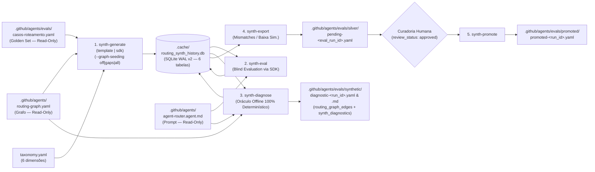

# Guia do Usuário: Pipeline Sintético de Roteamento (`synth-*`) e GitHub Copilot SDK

Este guia (*how-to*) apresenta o passo a passo prático para instalar o pacote `governance-runner`, configurar a autenticação com o **GitHub Copilot SDK Python** (`COPILOT_SDK_TOKEN`) e operar os cinco estágios do pipeline de geração e avaliação sintética de roteamento do `@agent-router` (`synth-generate`, `synth-eval`, `synth-export` e `synth-promote`) com persistência e deduplicação em **SQLite**.

---

## 1. Visão Geral e Arquitetura do Fluxo

O pipeline `synth-*` automatiza a descoberta de *hard negatives* (casos em que o `@agent-router` erra ou não emite rota parseável na delegação) sem contaminar o conjunto canônico (*Golden Set* em `.github/agents/evals/casos-roteamento.yaml`).



### Garantias Arquiteturais

- **Imutabilidade das 3 Fontes Read-Only (CA-01 / CA-07)**: `.github/agents/evals/casos-roteamento.yaml` (Golden Set), `.github/agents/routing-graph.yaml` (Grafo de Roteamento) e `.github/agents/agent-router.agent.md` (Prompt do Router) são **estritamente Read-Only** e protegidos por *denylist* imutável (`FONTES_READ_ONLY_PROTEGIDAS`), mesmo quando `--allow-root` é informado. Qualquer tentativa de sobrescrever esses arquivos, usar *path traversal* (`..`) ou gravar fora dos diretórios permitidos aborta a execução com **exit code `5`** no `synth-diagnose` (`DiagnosticPathError`) e **exit code `2`** no `synth-export` / `synth-promote` (`PermissionError`).
- **Zero Discovery (R-054) e Blind Evaluation Estrita (CA-06)**: Durante `--use-case synth-eval`, o `@agent-router` é avaliado às cegas (recebendo apenas `{prompt_text, system_prompt}` com a tool sintética `delegar` ou fallback de banner textual). Nem `expected_route`, nem `graph_edge_id`, `seed_source` ou o conteúdo de `.github/agents/routing-graph.yaml` vazam para o modelo avaliado, e o veredito (`matched`, `mismatched`, `unparseable`, `error`) é computado apenas após a resposta.
- **Diagnóstico 100% Offline e Determinístico (`synth-diagnose` — CA-05)**: O estágio `--use-case synth-diagnose` é 100% offline (0 chamadas LLM, 0 consumo de `COPILOT_SDK_TOKEN` / `GOV_MAX_PREMIUM_REQUESTS`), indexando `routing_graph_edges`, gravando `synth_diagnostics` no SQLite e exportando os artefatos determinísticos bit-a-bit `.github/agents/evals/synthetic/diagnostic-<run_id>.yaml` e `diagnostic-<run_id>.md` com `AVISO_HITL`.
- **Portões Determinísticos de Qualidade (`filters.py`)**: Todo candidato em `synth-generate` passa por normalização canônica (`normalizar`), deduplicação exata SHA-256 (`verificar_hash_unico`), teto de similaridade Jaccard (`max_similarity < --similarity-threshold`, default `0.85`) e bloqueio de injeção de rota explícita (`contem_override_explicito`, exceto na dimensão `adversarial_override`).
- **Governança de Orçamento (`budget.py`)**: Nenhuma chamada ao GitHub Copilot SDK (`synth-eval` ou `synth-generate --generator-mode sdk`) inicia sem `--max-premium-requests > 0` (ou `GOV_MAX_PREMIUM_REQUESTS`).

---
## 2. Pré-requisitos e Instalação

- **Python**: `>= 3.11`
- **Pacote `governance-runner`**: localizado em `tools/headless-governance-runner/`.

### Instalação em modo editável (Desenvolvimento + Testes + Copilot SDK)

> **Nota sobre o pacote `github-copilot-sdk` no PyPI**: No `pyproject.toml`, o extra opcional `[sdk]` declara `github-copilot-sdk>=1.0.0`, porém no PyPI o pacote oficial `github-copilot-sdk` encontra-se atualmente na série `0.x` (*Technical Preview*). Por isso, instale primeiro o pacote em modo editável com o extra `[dev]` e, em seguida, instale `github-copilot-sdk` diretamente via `pip`.

Na raiz do repositório (`D:\workspace\deep-agents-copilot`):

**PowerShell:**

```powershell
python -m pip install -e "tools/headless-governance-runner[dev]"
python -m pip install github-copilot-sdk
```

**Windows `cmd.exe`:**

```cmd
python -m pip install -e "tools/headless-governance-runner[dev]"
python -m pip install github-copilot-sdk
```

**Linux / macOS (`bash`):**

```bash
python -m pip install -e "tools/headless-governance-runner[dev]"
python -m pip install github-copilot-sdk
```

Se utilizar `uv`:

**PowerShell:**

```powershell
uv pip install -e "tools/headless-governance-runner[dev]"
uv pip install github-copilot-sdk
```

**Windows `cmd.exe`:**

```cmd
uv pip install -e "tools/headless-governance-runner[dev]"
uv pip install github-copilot-sdk
```

**Linux / macOS (`bash`):**

```bash
uv pip install -e "tools/headless-governance-runner[dev]"
uv pip install github-copilot-sdk
```

### Verificação da Instalação

Verifique se o entrypoint CLI está disponível:

**PowerShell:**

```powershell
governance-runner --help
# Ou via módulo Python:
python -m governance_runner.cli --help
```

**Windows `cmd.exe`:**

```cmd
governance-runner --help
REM Ou via módulo Python:
python -m governance_runner.cli --help
```

**Linux / macOS (`bash`):**

```bash
governance-runner --help
# Ou via módulo Python:
python -m governance_runner.cli --help
```

---

## 3. Configuração e Autenticação do GitHub Copilot SDK (`COPILOT_SDK_TOKEN`)

### Como funciona a autenticação no `sdk_adapter.py`

O adaptador `criar_cliente_sdk_real(token, modelo=None)` em `src/governance_runner/runner/sdk_adapter.py` realiza importação tardia (*lazy import*) do módulo `copilot` (`github-copilot-sdk`) e instancia `CopilotClient({"github_token": token})` com:

- **Validação fail-fast**: se `token` for vazio ou apenas espaços, levanta `SDKAuthenticationError` imediatamente antes de criar a sessão;
- **Timeout de segurança**: cada sessão tem timeout rígido de **120 segundos** (`_TIMEOUT_SESSAO_SEGUNDOS = 120.0`) para evitar *hang* indefinido em CI caso o evento `SessionIdleData` não seja emitido;
- **Classificação de erros 401/403**: exceções contendo marcadores de falha de autenticação (`401`, `403`, `unauthorized`, `forbidden`, `invalid token`, `expired`) são convertidas em `SDKAuthenticationError`.
- **Quando o token é exigido**: `--use-case synth-eval`, `--use-case synth-generate --generator-mode sdk` e `--use-case agent-audit`.
- **Quando o token NÃO é exigido (100% offline, custo zero)**: `--use-case synth-generate --generator-mode template` (default), `--use-case synth-diagnose`, `--use-case synth-export` e `--use-case synth-promote`.

> **Regra de Segurança (R-043 / RK-06)**: Nunca grave o token em código-fonte, arquivos YAML ou arquivos `.env` versionados. Exporte-o exclusivamente como variável de ambiente na sessão do terminal ou via GitHub Actions Secrets.

### Como obter e exportar o token por Sistema Operacional / Shell

Você pode utilizar um **Fine-Grained PAT / GitHub App Installation Token** com permissão Copilot ou extrair o token da sua sessão autenticada do GitHub CLI (`gh auth token`).

**PowerShell:**

```powershell
$env:COPILOT_SDK_TOKEN = (gh auth token)
# Ou manualmente:
$env:COPILOT_SDK_TOKEN = "ghu_seu_token_aqui"
$env:GOV_MAX_PREMIUM_REQUESTS = "20"
```

**Windows `cmd.exe`:**

```cmd
for /f "tokens=*" %i in ('gh auth token') do set COPILOT_SDK_TOKEN=%i
REM Ou manualmente:
set COPILOT_SDK_TOKEN=ghu_seu_token_aqui
set GOV_MAX_PREMIUM_REQUESTS=20
```

**Linux / macOS (`bash`):**

```bash
export COPILOT_SDK_TOKEN="$(gh auth token)"
# Ou manualmente:
export COPILOT_SDK_TOKEN="ghu_seu_token_aqui"
export GOV_MAX_PREMIUM_REQUESTS="20"
```

### Variáveis de Ambiente Suportadas

| Variável de Ambiente | Onde é lida | Default | Descrição |
| :--- | :--- | :--- | :--- |
| `COPILOT_SDK_TOKEN` | `cli.py` | *(nenhum — fail-fast)* | Token de autenticação repassado ao `CopilotClient`. Se ausente ou vazio quando exigido, encerra com exit code `2`. |
| `GOV_MAX_PREMIUM_REQUESTS` | `use_cases.py` / `budget.py` | *(obrigatório em `synth-eval` e `generate sdk`)* | Teto de *premium requests* da execução (sobrescrito por `--max-premium-requests`). Validado **antes** do token (exit code `2` se ausente ou `<= 0`). |
| `GOV_SYNTH_DB` | `storage.py` | `.cache/routing_synth_history.db` | Caminho padrão do banco SQLite caso `--db` seja omitido. |
---

## 4. Passo a Passo Completo de Uso (Receitas Práticas)

> **Mapeamento de Nomenclatura Exata das Flags CLI (`src/governance_runner/cli.py`)**:
> - Seleção do modo: `--use-case` (e não `--mode`)
> - Quantidade por estrato `(agente_alvo, dimensao_perturbacao)`: `--per-stratum` (e não `--count`)
> - Limiar de similaridade cosseno TF-IDF: `--sim-threshold` (e não `--similarity-threshold`)
> - Run de geração avaliado: `--source-run-id` (e não `--gen-run-id`)
> - Filtro de falhas na exportação: `--only-failures` / `--no-only-failures` (e não `--verdict`)

### Passo 1 — Gerar Prompts Sintéticos (`--use-case synth-generate`)

Lê as sementes somente-leitura do Golden Set (`.github/agents/evals/casos-roteamento.yaml` — suítes `canonicos`, `ambiguos`, `regressao` e, quando `--include-security` é informado, `seguranca`), aloca estratos pelas 8 dimensões de `src/governance_runner/synth/taxonomy.yaml` (`parafrase`, `ruido_ortografico`, `code_switching_pt_en`, `omissao_palavra_chave`, `distrator_outro_agente`, `multi_intencao`, `comprimento_extremo`, `registro_informal`) e aplica o funil de deduplicação em 2 camadas + anti-override.

#### 1.1 Modo `template` (100% Offline, Custo Zero — Ideal para Testar o Funil)

**PowerShell:**

```powershell
governance-runner `
  --use-case synth-generate `
  --generator-mode template `
  --targets "python-router,test-strategy" `
  --dimensions "parafrase,ruido_ortografico" `
  --per-stratum 2 `
  --rng-seed 42 `
  --sim-threshold 0.85 `
  --max-attempts 3
```

**Windows `cmd.exe`:**

```cmd
governance-runner ^
  --use-case synth-generate ^
  --generator-mode template ^
  --targets "python-router,test-strategy" ^
  --dimensions "parafrase,ruido_ortografico" ^
  --per-stratum 2 ^
  --rng-seed 42 ^
  --sim-threshold 0.85 ^
  --max-attempts 3
```

**Linux / macOS (`bash`):**

```bash
governance-runner \
  --use-case synth-generate \
  --generator-mode template \
  --targets "python-router,test-strategy" \
  --dimensions "parafrase,ruido_ortografico" \
  --per-stratum 2 \
  --rng-seed 42 \
  --sim-threshold 0.85 \
  --max-attempts 3
```

**Saída esperada (impressa por `cli.py`):**

```text
synth-generate: run_id=d4e5f6a7b8c940128394a5b6c7d8e9f0 status=completed {'n_candidates': 4, 'n_accepted': 4, 'n_rejected_hash': 0, 'n_rejected_similarity': 0, 'n_rejected_override': 0}
```

#### 1.2 Modo `sdk` (Geração via LLM no GitHub Copilot SDK)

**PowerShell:**

```powershell
$env:COPILOT_SDK_TOKEN = (gh auth token)
governance-runner `
  --use-case synth-generate `
  --generator-mode sdk `
  --max-premium-requests 15 `
  --targets "python-router,test-strategy" `
  --dimensions "parafrase,ruido_ortografico" `
  --per-stratum 2 `
  --sim-threshold 0.85 `
  --model "claude-haiku-5.5"
```

**Windows `cmd.exe`:**

```cmd
for /f "tokens=*" %i in ('gh auth token') do set COPILOT_SDK_TOKEN=%i
governance-runner ^
  --use-case synth-generate ^
  --generator-mode sdk ^
  --max-premium-requests 15 ^
  --targets "python-router,test-strategy" ^
  --dimensions "parafrase,ruido_ortografico" ^
  --per-stratum 2 ^
  --sim-threshold 0.85 ^
  --model "claude-haiku-5.5"
```

**Linux / macOS (`bash`):**

```bash
export COPILOT_SDK_TOKEN="$(gh auth token)"
governance-runner \
  --use-case synth-generate \
  --generator-mode sdk \
  --max-premium-requests 15 \
  --targets "python-router,test-strategy" \
  --dimensions "parafrase,ruido_ortografico" \
  --per-stratum 2 \
  --sim-threshold 0.85 \
  --model "claude-haiku-5.5"
```

**Saída esperada (impressa por `cli.py`):**

```text
synth-generate: run_id=e5f6a7b8c9d0412394a5b6c7d8e9f0a1 status=completed {'n_candidates': 5, 'n_accepted': 4, 'n_rejected_hash': 0, 'n_rejected_similarity': 1, 'n_rejected_override': 0}
```
#### 1.3 Expansão de Sementes via Grafo (`--graph-seeding off|gaps|all`)

O `synth-generate` pode expandir automaticamente o *pool* de sementes a partir das arestas de `.github/agents/routing-graph.yaml` (`routing_graph.py` e `seeds.py`), persistindo a rastreabilidade em `synth_prompts.seed_source`, `synth_prompts.graph_edge_id` e `synth_prompts.graph_edge_resolution`:

| Modo (`--graph-seeding`) | Comportamento | `seed_source` | `graph_edge_resolution` |
| :--- | :--- | :--- | :--- |
| `off` *(default)* | 100% compatível com v1: utiliza apenas os casos manuais de `.github/agents/evals/casos-roteamento.yaml`. | `manual` | `NULL` |
| `gaps` | Mantém as sementes do Golden Set (resolvendo a aresta no grafo) e gera sementes sintéticas determinísticas para rotas de `routing-graph.yaml` com menos de `--graph-min-coverage` (default: `3`) sementes no Golden Set. | `manual` / `graph_gap` | `direct` (sintéticas) ou `exact_keyword` / `unique_target` / `ambiguous` / `unmapped` (manuais) |
| `all` | Combina todas as sementes do Golden Set com sementes sintéticas para todas as arestas elegíveis de `routing-graph.yaml` (mínimo de `--graph-min-coverage` por aresta). | `manual` / `graph_all` | `direct` (sintéticas) ou resolução do grafo (manuais) |

- **Exclusão automática de protocolo interno (`TIPOS_ARESTA_EXCLUIDOS_SEEDING`)**: Arestas com `tipo` igual a `health_check` ou `mandatory_pre_step` são excluídas automaticamente da geração de sementes. Arestas `security_gate` (assim como `domain_router`, `direct_specialist`, `orchestrator`, etc.) **são incluídas**.

**PowerShell:**

```powershell
governance-runner `
  --use-case synth-generate `
  --generator-mode template `
  --graph-seeding gaps `
  --graph-min-coverage 1 `
  --routing-graph .github/agents/routing-graph.yaml `
  --targets "python-router,ejb-router,oracle-database-specialist" `
  --dimensions "parafrase,ruido_ortografico,ambiguidade_fronteira" `
  --count 9 `
  --seed 42
```

**Windows `cmd.exe`:**

```cmd
governance-runner ^
  --use-case synth-generate ^
  --generator-mode template ^
  --graph-seeding gaps ^
  --graph-min-coverage 1 ^
  --routing-graph .github/agents/routing-graph.yaml ^
  --targets "python-router,ejb-router,oracle-database-specialist" ^
  --dimensions "parafrase,ruido_ortografico,ambiguidade_fronteira" ^
  --count 9 ^
  --seed 42
```

**Linux / macOS (`bash`):**

```bash
governance-runner \
  --use-case synth-generate \
  --generator-mode template \
  --graph-seeding gaps \
  --graph-min-coverage 1 \
  --routing-graph .github/agents/routing-graph.yaml \
  --targets "python-router,ejb-router,oracle-database-specialist" \
  --dimensions "parafrase,ruido_ortografico,ambiguidade_fronteira" \
  --count 9 \
  --seed 42
```

#### 1.4 Valores Válidos para `--targets` e `--dimensions`

##### Dimensões Válidas para `--dimensions` (`src/governance_runner/synth/taxonomy.yaml`)

Qualquer ID fora da tabela abaixo levanta `KeyError("Dimensao de perturbacao desconhecida: ...")` em `alocar_estratos()`:

| ID da Dimensão (`--dimensions`) | Descrição em `taxonomy.yaml` | Restrições |
| :--- | :--- | :--- |
| `parafrase` | Reescrita sinonímica preservando a intenção técnica original sem repetir o fraseado literal da semente. | `preservar_intencao: true` |
| `ruido_ortografico` | Introdução controlada de erros de digitação comuns, omissão de acentos e abreviações de teclado. | `preservar_intencao: true` |
| `code_switching_pt_en` | Mistura natural de termos técnicos em inglês com estrutura frasal em português. | `preservar_intencao: true` |
| `omissao_palavra_chave` | Descrição do problema pelos sintomas ou efeito esperado omitindo o nome explícito da tecnologia/ferramenta. | `preservar_intencao: true` |
| `distrator_outro_agente` | Inclusão de contexto periférico que menciona outra stack ou domínio sem alterar a tarefa principal. | `preservar_intencao: true` |
| `multi_intencao` | Solicitação composta em que uma intenção principal domina uma sub-tarefa secundária. | `preservar_intencao: true` |
| `comprimento_extremo` | Variação para prompt telegrafado muito curto (`<= 8` palavras) ou detalhado longo (`>= 80` palavras). | `curto_max_palavras: 8`, `longo_min_palavras: 80` |
| `registro_informal` | Linguagem coloquial de chat de equipe mantendo o objetivo técnico inalterado. | `preservar_intencao: true` |

##### Agentes-Alvo Válidos para `--targets` (`.github/agents/evals/casos-roteamento.yaml`)

O carregador `carregar_seeds_golden()` (`src/governance_runner/synth/golden.py`) filtra as sementes cujo `expected.agent_route` pertença ao conjunto informado em `--targets`.

> **Atenção (`n_candidates: 0` vs. `--graph-seeding gaps|all`)**: Com `--graph-seeding off` (default), se você passar em `--targets` apenas agentes ausentes de `.github/agents/evals/casos-roteamento.yaml` (ex.: `python-router`, `ejb-router`, `oracle-database-specialist`), `carregar_seeds_golden()` retornará zero sementes e o `synth-generate` terminará com `{'n_candidates': 0, ...}`. Ao informar `--graph-seeding gaps --graph-min-coverage 1` (ou `--graph-seeding all`), o gerador sintetiza sementes determinísticas diretamente das arestas elegíveis de `.github/agents/routing-graph.yaml` e produz candidatos normalmente.

Os **38 valores únicos de `agent_route`** atualmente presentes em `.github/agents/evals/casos-roteamento.yaml` são:

| Categoria | Valores de `expected.agent_route` em `.github/agents/evals/casos-roteamento.yaml` |
| :--- | :--- |
| **Domain Routers** | `angular-router`, `database-router`, `react-router`, `spring-boot-router`, `spring-reactive-router`, `struts-router` |
| **Planejamento, Arquitetura e Requisitos** | `adr-sentinel`, `business-rules-extractor`, `ddd-bounded-context-mapper`, `feature-planner`, `refactor-planner`, `requirements-analyst`, `tech-solution-architect`, `test-strategy` |
| **Engenharia, Qualidade e Operações** | `angular-engineer`, `binding-initializer`, `bug-triage`, `code-review`, `code-style-enforcer`, `codegraph-engine`, `compliance-guardrails`, `debugger`, `deep-search`, `devops-engineer`, `docs-engineer`, `performance-agent`, `prompt-structuring`, `repo-hygiene-auditor`, `security-reviewer`, `test-engineer` |
| **Governança e Meta-Agentes** | `agent-auditor`, `agent-router`, `governance-factory`, `governance-maintainer` |
| **Rotas Especiais / Compostas (Suítes `ambiguos` e `seguranca`)** | `SEM_SPAWN`, `retorno`, `bug-triage|test-strategy|refactor-planner|tech-solution-architect|docs-engineer`, `spring-boot-router|angular-router|spring-reactive-router` |

#### 1.4 Modelos Permitidos para `--model` (`model-allowlist.yaml`)

No adaptador `src/governance_runner/runner/sdk_adapter.py`, a flag `--model` é repassada em `client.create_session(...)` via `model=request.modelo or self._modelo`:

- O GitHub Copilot SDK (`github/copilot-sdk` / `copilot-cli`) exige o **identificador em formato slug (`kebab-case` minúsculo com ponto na versão decimal)** — ex.: `claude-sonnet-5.5` — e **não** o nome de exibição com espaços (`"Claude Sonnet 5.5"`). Se um nome inválido for passado, o runtime do Copilot faz fallback silencioso para o modelo padrão (`Auto`).

**Tabela Oficial de Modelos Permitidos para `--model` (estritamente restrita ao `model-allowlist.yaml`):**

| Rank de Custo | Nome na Allowlist (`model-allowlist.yaml`) | Provider | Nível de Custo (Créditos In / Out por 1M) | Valor para `--model` no Copilot SDK (Slug) | Recomendação de Uso no Pipeline `synth-*` |
| :---: | :--- | :--- | :--- | :--- | :--- |
| — | `Auto` (`pinnable: false`) | `github` | Variável | *(omitir a flag `--model`)* | Usa o seletor automático do runtime Copilot |
| **1** | `Claude Haiku 5.5` | `anthropic` | **Low** (`10` / `50`) | `claude-haiku-5.5` | **Recomendado para `synth-generate --generator-mode sdk`** (geração rápida e de baixo custo) |
| **2** | `Gemini 3.8 Flash` | `google` | **Low** (`75` / `375`) | `gemini-3.8-flash` | Alternativa rápida de baixo custo para geração sintética |
| **3** | `Grok 4.7` | `xai` | **Medium** (`200` / `600`) | `grok-4.7` | Avaliação intermediária ou geração diversificada |
| **4** | `Gemini 4 Argon` | `google` | **Medium** (`200` / `1000`) | `gemini-4-argon` | Avaliação de roteamento em lote (`synth-eval`) |
| **5** | `Claude Sonnet 5.5` | `anthropic` | **Medium** (`300` / `1500`) | `claude-sonnet-5.5` | **Recomendado para `synth-eval`** (paridade com o modelo padrão do `agent-router`) |
| **6** | `GPT-6.1 Sol` | `openai` | **Medium** (`300` / `1500`) | `gpt-6.1-sol` | Alternativa de paridade média para `synth-eval` ou geração cross-family (anti self-bias) |
| **7** | `Claude Opus 5.5` | `anthropic` | **High** (`500` / `2500`) | `claude-opus-5.5` | Uso restrito a auditoria profunda de casos ambíguos (alto consumo de orçamento) |

> **Governança de Modelos (R-038 / R-053)**: Nunca utilize modelos fora desta tabela (como `gpt-4o`, `claude-3.5-sonnet` ou `o1`). Para evitar *self-preference bias* (RK-10), recomenda-se gerar prompts com um modelo de custo baixo/família distinta (ex.: `--model "claude-haiku-5.5"` ou `--model "gemini-3.8-flash"`) e avaliar o `@agent-router` com `--model "claude-sonnet-5.5"` ou `--model "gpt-6.1-sol"`.
---

### Passo 2 — Avaliar Prompts em Modo Cego (`--use-case synth-eval`)

Executa os prompts gerados contra o `@agent-router` (`.github/agents/agent-router.agent.md`) via GitHub Copilot SDK, capturando a rota observada via tool hook `delegar()` (`route_source = 'tool_hook'`) ou fallback de banner textual (`route_source = 'text_banner'`) e classificando cada avaliação em `synth_evaluations.verdict` como `matched`, `mismatched`, `unparseable` ou `error`.

**PowerShell:**

```powershell
governance-runner `
  --use-case synth-eval `
  --source-run-id d4e5f6a7b8c940128394a5b6c7d8e9f0 `
  --pending `
  --max-premium-requests 20 `
  --limit 20 `
  --model "claude-sonnet-5.5"
```

**Windows `cmd.exe`:**

```cmd
governance-runner ^
  --use-case synth-eval ^
  --source-run-id d4e5f6a7b8c940128394a5b6c7d8e9f0 ^
  --pending ^
  --max-premium-requests 20 ^
  --limit 20 ^
  --model "claude-sonnet-5.5"
```

**Linux / macOS (`bash`):**

```bash
governance-runner \
  --use-case synth-eval \
  --source-run-id d4e5f6a7b8c940128394a5b6c7d8e9f0 \
  --pending \
  --max-premium-requests 20 \
  --limit 20 \
  --model "claude-sonnet-5.5"
```

**Saída esperada (impressa por `cli.py`):**

```text
synth-eval: run_id=a1b2c3d4e5f647898012b3c4d5e6f7a8 status=completed {'n_avaliados': 4, 'n_passed': 3, 'n_unparseable': 0, 'n_errors': 0, 'premium_requests_used': 4}
```

---

### Passo 3 — Inspecionar o Histórico no SQLite (Schema v2 — `.cache/routing_synth_history.db`)

O banco SQLite opera em modo WAL com **Schema v2** (`PRAGMA user_version = 2`, `schema_meta.schema_version = '2'`) e possui **6 tabelas operacionais** (`synth_runs`, `synth_prompts`, `synth_evaluations`, `synth_exports`, `routing_graph_edges` e `synth_diagnostics`) além de `schema_meta`. Bancos criados no schema v1 são migrados automaticamente de forma transacional e idempotente sem `executescript()`, adicionando as colunas `seed_source`, `graph_edge_id`, `graph_edge_resolution` (em `synth_prompts`) e `routing_graph_sha256` (em `synth_runs`).

#### 3.1 Inspecionar Prompts por `seed_source`, `graph_edge_id` e `graph_edge_resolution` (`synth_prompts`)

**PowerShell:**

```powershell
python -c "import sqlite3; con=sqlite3.connect('.cache/routing_synth_history.db'); print('\n'.join(str(r) for r in con.execute('SELECT prompt_id, agente_alvo, seed_source, graph_edge_id, graph_edge_resolution, ROUND(max_similarity, 3), substr(text, 1, 60) FROM synth_prompts ORDER BY created_at DESC LIMIT 15')))"
```

**Windows `cmd.exe`:**

```cmd
python -c "import sqlite3; con=sqlite3.connect('.cache/routing_synth_history.db'); print('\n'.join(str(r) for r in con.execute('SELECT prompt_id, agente_alvo, seed_source, graph_edge_id, graph_edge_resolution, ROUND(max_similarity, 3), substr(text, 1, 60) FROM synth_prompts ORDER BY created_at DESC LIMIT 15')))"
```

**Linux / macOS (`bash`):**

```bash
python -c "import sqlite3; con=sqlite3.connect('.cache/routing_synth_history.db'); print('\n'.join(str(r) for r in con.execute('SELECT prompt_id, agente_alvo, seed_source, graph_edge_id, graph_edge_resolution, ROUND(max_similarity, 3), substr(text, 1, 60) FROM synth_prompts ORDER BY created_at DESC LIMIT 15')))"
```

#### 3.2 Inspecionar Avaliações e Vereditos (`synth_evaluations`)

**PowerShell:**

```powershell
python -c "import sqlite3; con=sqlite3.connect('.cache/routing_synth_history.db'); print('\n'.join(str(r) for r in con.execute('SELECT eval_id, eval_run_id, expected_route, observed_route, verdict, route_source, latency_ms FROM synth_evaluations ORDER BY created_at DESC LIMIT 15')))"
```

**Windows `cmd.exe`:**

```cmd
python -c "import sqlite3; con=sqlite3.connect('.cache/routing_synth_history.db'); print('\n'.join(str(r) for r in con.execute('SELECT eval_id, eval_run_id, expected_route, observed_route, verdict, route_source, latency_ms FROM synth_evaluations ORDER BY created_at DESC LIMIT 15')))"
```

**Linux / macOS (`bash`):**

```bash
python -c "import sqlite3; con=sqlite3.connect('.cache/routing_synth_history.db'); print('\n'.join(str(r) for r in con.execute('SELECT eval_id, eval_run_id, expected_route, observed_route, verdict, route_source, latency_ms FROM synth_evaluations ORDER BY created_at DESC LIMIT 15')))"
```

#### 3.3 Inspecionar Arestas Indexadas (`routing_graph_edges`) e Diagnósticos (`synth_diagnostics`)

**PowerShell:**

```powershell
python -c "import sqlite3; con=sqlite3.connect('.cache/routing_synth_history.db'); print('=== EDGES ==='); print('\n'.join(str(r) for r in con.execute('SELECT edge_id, de, para, tipo, valida FROM routing_graph_edges LIMIT 10'))); print('=== DIAGNOSTICS ==='); print('\n'.join(str(r) for r in con.execute('SELECT diag_id, eval_run_id, total_evaluated, ROUND(global_accuracy, 4), ROUND(macro_f1, 4), yaml_path FROM synth_diagnostics ORDER BY created_at DESC LIMIT 5')))"
```

**Windows `cmd.exe`:**

```cmd
python -c "import sqlite3; con=sqlite3.connect('.cache/routing_synth_history.db'); print('=== EDGES ==='); print('\n'.join(str(r) for r in con.execute('SELECT edge_id, de, para, tipo, valida FROM routing_graph_edges LIMIT 10'))); print('=== DIAGNOSTICS ==='); print('\n'.join(str(r) for r in con.execute('SELECT diag_id, eval_run_id, total_evaluated, ROUND(global_accuracy, 4), ROUND(macro_f1, 4), yaml_path FROM synth_diagnostics ORDER BY created_at DESC LIMIT 5')))"
```

**Linux / macOS (`bash`):**

```bash
python -c "import sqlite3; con=sqlite3.connect('.cache/routing_synth_history.db'); print('=== EDGES ==='); print('\n'.join(str(r) for r in con.execute('SELECT edge_id, de, para, tipo, valida FROM routing_graph_edges LIMIT 10'))); print('=== DIAGNOSTICS ==='); print('\n'.join(str(r) for r in con.execute('SELECT diag_id, eval_run_id, total_evaluated, ROUND(global_accuracy, 4), ROUND(macro_f1, 4), yaml_path FROM synth_diagnostics ORDER BY created_at DESC LIMIT 5')))"
```

---

### Passo 4 — Diagnosticar Divergências Offline (`--use-case synth-diagnose`)

Executa o oráculo determinístico 100% offline (`diagnostics.py` e `diagnostic_exporter.py`), cruzando `synth_evaluations`, `synth_prompts`, `.github/agents/routing-graph.yaml` e `.github/agents/agent-router.agent.md` (0 chamadas LLM, 0 consumo de `COPILOT_SDK_TOKEN` / `GOV_MAX_PREMIUM_REQUESTS`).

**PowerShell:**

```powershell
governance-runner `
  --use-case synth-diagnose `
  --eval-run-id a1b2c3d4e5f647898012b3c4d5e6f7a8 `
  --routing-graph .github/agents/routing-graph.yaml `
  --router-agent .github/agents/agent-router.agent.md `
  --min-support 3 `
  --format both
```

**Windows `cmd.exe`:**

```cmd
governance-runner ^
  --use-case synth-diagnose ^
  --eval-run-id a1b2c3d4e5f647898012b3c4d5e6f7a8 ^
  --routing-graph .github/agents/routing-graph.yaml ^
  --router-agent .github/agents/agent-router.agent.md ^
  --min-support 3 ^
  --format both
```

**Linux / macOS (`bash`):**

```bash
governance-runner \
  --use-case synth-diagnose \
  --eval-run-id a1b2c3d4e5f647898012b3c4d5e6f7a8 \
  --routing-graph .github/agents/routing-graph.yaml \
  --router-agent .github/agents/agent-router.agent.md \
  --min-support 3 \
  --format both
```

**Saída esperada no terminal:**

```text
synth-diagnose: diag_id=7c8d9e0f1a2b4345867890abcdef1234 eval_run_id=a1b2c3d4e5f647898012b3c4d5e6f7a8 global_accuracy=0.85 macro_f1=0.8123 yaml=.github/agents/evals/synthetic/diagnostic-a1b2c3d4e5f647898012b3c4d5e6f7a8.yaml md=.github/agents/evals/synthetic/diagnostic-a1b2c3d4e5f647898012b3c4d5e6f7a8.md
```

**Estrutura dos artefatos (`.github/agents/evals/synthetic/diagnostic-<run_id>.yaml` e `diagnostic-<run_id>.md`):**

```yaml
version: 1
aviso_hitl: Artefato consultivo (HITL). Nenhum arquivo-alvo é modificado automaticamente.
diag_id: 7c8d9e0f1a2b4345867890abcdef1234
eval_run_id: a1b2c3d4e5f647898012b3c4d5e6f7a8
routing_graph_sha256: <sha256-64-hex>
router_agent_sha256: <sha256-64-hex>
sumario:
  total_evaluated: 20
  global_accuracy: 0.85
  macro_f1: 0.8123
  verdicts: {matched: 17, mismatched: 3, unparseable: 0, error: 0}
por_agente: [...]
por_aresta: [...]
por_dimensao: [...]
matriz_confusao_top20: [...]
colisoes_keywords: [...]
divergencias_grafo_vs_router: {arestas_destino_inexistente: [], nos_ausentes_no_router: [], citados_fora_do_grafo: []}
sugestoes:
- id: SUG-001
  codigo: SUG-DISAMBIG
  categoria_divergencia: KEYWORD_COLLISION
  severidade: alta
  alvo_arquivo: .github/agents/routing-graph.yaml
  alvo_ancora: arestas[entry->test-strategy vs entry->test]
  evidencias: [9f8e7d6c5b4a11223344556677889900]
  proposta_texto: Desambiguar keywords compartilhadas ...
```

#### 4.1 As 4 Categorias de Divergência (`CATEGORIAS_DIVERGENCIA`)

| Categoria | Descrição Técnica | Fonte de Detecção |
| :--- | :--- | :--- |
| `KEYWORD_COLLISION` | Interseção de *keywords* normalizadas entre arestas concorrentes (`de` igual e `para` distinto), correlacionada ou não a confusões na matriz. | `routing-graph.yaml` × `synth_evaluations` |
| `PROMPT_DRIFT` | Divergência estrutural entre `routing-graph.yaml` e os agentes `@<id>` documentados em `agent-router.agent.md`. | `routing-graph.yaml` × `agent-router.agent.md` |
| `COVERAGE_GAP` | Rotas ou arestas com `support < --min-support` (default: `3`) ou `seed_count_golden == 0`. | `synth_evaluations` × `casos-roteamento.yaml` |
| `CONFIDENCE_CALIBRATION` | Falsos negativos (`fn > 0`) em arestas onde n-gramas recorrentes não constam em `keywords`. | `synth_prompts` × `routing-graph.yaml` |

#### 4.2 Os 6 Códigos de Sugestão Acionável (`SugestaoAcionavel.codigo`)

| Código | Categoria | Severidade | Arquivo-Alvo | Ação Recomendada (HITL) |
| :--- | :--- | :--- | :--- | :--- |
| `SUG-KW-ADD` | `CONFIDENCE_CALIBRATION` | `media` | `.github/agents/routing-graph.yaml` | Adicionar n-gramas candidatos dos falsos negativos em `arestas[<edge_id>:<para>]`. |
| `SUG-KW-COLLISION` | `KEYWORD_COLLISION` | `media` | `.github/agents/routing-graph.yaml` | Separar *keywords* compartilhadas entre arestas concorrentes sem confusão empírica ainda observada. |
| `SUG-DISAMBIG` | `KEYWORD_COLLISION` | `alta` | `.github/agents/routing-graph.yaml` | Desambiguar *keywords* e ajustar `prioridade` onde houve confusão empírica (`expected_route -> observed_route`). |
| `SUG-GOLDEN-GAP` | `COVERAGE_GAP` | `baixa`/`media` | `.github/agents/evals/casos-roteamento.yaml` | Expandir cobertura com `--graph-seeding gaps` ou novos casos para rotas com `support < --min-support`. |
| `SUG-ROUTER-DOC` | `PROMPT_DRIFT` | `media` | `.github/agents/agent-router.agent.md` / `routing-graph.yaml` | Sincronizar agentes entre `routing-graph.yaml::nos` e `agent-router.agent.md`. |
| `SUG-GRAPH-PHANTOM` | `PROMPT_DRIFT` | `alta` | `.github/agents/routing-graph.yaml` | Corrigir ou remover aresta fantasma cujo destino `para` não existe em `routing-graph.yaml::nos`. |

---
### Passo 5 — Exportar Divergências (*Hard Negatives*) para Quarentena Silver (`--use-case synth-export`)

Gera `.github/agents/evals/synthetic/casos-roteamento-silver-<YYYYMMDD-HHMMSS>.yaml` contendo apenas falhas (`passed = 0`, isto é, `mismatched`/`unparseable`/`error`, por padrão com `--only-failures`) e opcionalmente casos limítrofes de alta similaridade (`--include-near-boundary`, `max_similarity >= 0.75`):

**PowerShell:**

```powershell
governance-runner `
  --use-case synth-export `
  --eval-run-id a1b2c3d4e5f647898012b3c4d5e6f7a8
```

**Windows `cmd.exe`:**

```cmd
governance-runner ^
  --use-case synth-export ^
  --eval-run-id a1b2c3d4e5f647898012b3c4d5e6f7a8
```

**Linux / macOS (`bash`):**

```bash
governance-runner \
  --use-case synth-export \
  --eval-run-id a1b2c3d4e5f647898012b3c4d5e6f7a8
```

**Saída esperada (impressa por `cli.py`):**

```text
synth-export: run_id=a1b2c3d4e5f647898012b3c4d5e6f7a8 status=completed {'n_exportados': 1}
```

**Estrutura exata do arquivo YAML Silver gerado por `exportar_silver()` (`exporter.py`):**

```yaml
version: '1.0'
origem: synth-export
eval_run_id: a1b2c3d4e5f647898012b3c4d5e6f7a8
casos:
- id: silver-9f8e7d6c5b4a
  descricao: test-strategy / parafrase
  input:
    solicitacao: preciso definir a estrategia de testes unitarios e mutacao para o servico
  expected:
    agent_route: test-strategy
  silver:
    prompt_id: 9f8e7d6c5b4a11223344556677889900
    eval_id: 11223344556677889900aabbccddeeff
    observed_route: test-engineer
    verdict: mismatched
    max_similarity: 0.4123
    review_status: pending
    corrected_route: null
```

---

### Passo 6 — Curadoria Humana e Promoção (`--use-case synth-promote`)

1. No arquivo Silver YAML (`.github/agents/evals/synthetic/casos-roteamento-silver-<YYYYMMDD-HHMMSS>.yaml`), revise cada item da lista `casos` e atualize o bloco aninhado `silver` dos casos aprovados definindo `review_status: approved` e `corrected_route: <agente-correto>`:

```yaml
version: '1.0'
origem: synth-export
eval_run_id: a1b2c3d4e5f647898012b3c4d5e6f7a8
casos:
- id: silver-9f8e7d6c5b4a
  descricao: test-strategy / parafrase
  input:
    solicitacao: preciso definir a estrategia de testes unitarios e mutacao para o servico
  expected:
    agent_route: test-strategy
  silver:
    prompt_id: 9f8e7d6c5b4a11223344556677889900
    eval_id: 11223344556677889900aabbccddeeff
    observed_route: test-engineer
    verdict: mismatched
    max_similarity: 0.4123
    review_status: approved
    corrected_route: test-strategy
```

2. **Modo Preview (sem `--confirm`, com `--stdout`)**: revalida a deduplicação contra o Golden Set e imprime no `stdout` o YAML candidato sem gravar arquivo em disco:

**PowerShell:**

```powershell
governance-runner `
  --use-case synth-promote `
  --silver .github/agents/evals/synthetic/casos-roteamento-silver-20261115-121000.yaml `
  --run-id lote-20261115 `
  --stdout
```

**Windows `cmd.exe`:**

```cmd
governance-runner ^
  --use-case synth-promote ^
  --silver .github/agents/evals/synthetic/casos-roteamento-silver-20261115-121000.yaml ^
  --run-id lote-20261115 ^
  --stdout
```

**Linux / macOS (`bash`):**

```bash
governance-runner \
  --use-case synth-promote \
  --silver .github/agents/evals/synthetic/casos-roteamento-silver-20261115-121000.yaml \
  --run-id lote-20261115 \
  --stdout
```

3. **Modo Gravação (`--confirm`)**: grava `.github/agents/evals/synthetic/promoted-<run_id>.yaml` e atualiza `synth_exports.status = 'promoted'` no SQLite para posterior revisão em Pull Request manual:

**PowerShell:**

```powershell
governance-runner `
  --use-case synth-promote `
  --silver .github/agents/evals/synthetic/casos-roteamento-silver-20261115-121000.yaml `
  --run-id lote-20261115 `
  --suite regressao `
  --confirm
```

**Windows `cmd.exe`:**

```cmd
governance-runner ^
  --use-case synth-promote ^
  --silver .github/agents/evals/synthetic/casos-roteamento-silver-20261115-121000.yaml ^
  --run-id lote-20261115 ^
  --suite regressao ^
  --confirm
```

**Linux / macOS (`bash`):**

```bash
governance-runner \
  --use-case synth-promote \
  --silver .github/agents/evals/synthetic/casos-roteamento-silver-20261115-121000.yaml \
  --run-id lote-20261115 \
  --suite regressao \
  --confirm
```

**Saída esperada (impressa por `cli.py`):**

```text
synth-promote: run_id=lote-20261115 status=completed {'n_promovidos': 1, 'n_duplicados': 0}
```

**Estrutura exata do arquivo promovido `.github/agents/evals/synthetic/promoted-lote-20261115.yaml`:**

```yaml
regressao:
- id: promoted-silver-9f8e7d6c5b4a
  descricao: test-strategy / parafrase
  input:
    solicitacao: preciso definir a estrategia de testes unitarios e mutacao para o servico
  expected:
    agent_route: test-strategy
```
---

## 5. Referência Completa de Flags CLI e Exit Codes

### Tabela de Flags (`src/governance_runner/cli.py`)

| Flag CLI | Caso(s) de Uso | Tipo / Default | Descrição |
| :--- | :--- | :--- | :--- |
| `--use-case` | Todos *(obrigatório)* | `{agent-audit, synth-generate, synth-eval, synth-diagnose, synth-export, synth-promote}` | Caso de uso a executar. |
| `--db` | `generate, eval, diagnose, export, promote` | `str` (`GOV_SYNTH_DB` ou `.cache/routing_synth_history.db`) | Caminho do arquivo SQLite WAL (Schema v2). |
| `--generator-mode`, `--generator` | `synth-generate` | `{sdk, template}` (`template`) | Motor offline (`template`) ou LLM (`sdk`). |
| `--count` | `synth-generate` | `int` (`20`) | Total de candidatos sintéticos a gerar. |
| `--seed` | `synth-generate` | `int` (`42`) | Semente determinística para alocação estratificada e PRNG. |
| `--targets` | `synth-generate` | `str` CSV (`None` = todos) | Lista de `agent_route` separados por vírgula. |
| `--dimensions` | `synth-generate` | `str` CSV (`None` = todas as 6) | Lista de IDs de dimensão de `taxonomy.yaml`. |
| `--similarity-threshold` | `synth-generate, synth-export` | `float` (`0.85`) | Teto máximo Jaccard em `generate`; limiar de baixa similaridade em `export`. |
| `--golden` | `synth-generate, synth-diagnose` | `str` (`.github/agents/evals/casos-roteamento.yaml`) | Caminho do Golden Set (Read-Only). |
| `--routing-graph` | `synth-generate, synth-diagnose` | `str` (`.github/agents/routing-graph.yaml`) | Caminho do Grafo de Roteamento (Read-Only). |
| `--graph-seeding` | `synth-generate` | `{off, gaps, all}` (`off`) | Modo de expansão de sementes via arestas elegíveis de `routing-graph.yaml`. |
| `--graph-min-coverage` | `synth-generate` | `int` (`3`) | Cobertura mínima por aresta quando `--graph-seeding` é `gaps` ou `all`. |
| `--run-id` | `synth-eval, synth-promote` | `str` (`None`) | Em `eval`: alias de `--source-run-id`; em `promote`: sufixo de `promoted-<run_id>.yaml`. |
| `--source-run-id` | `synth-eval` | `str` (`None`) | Filtra prompts de um `run_id` de `synth-generate`. |
| `--pending` | `synth-eval` | `bool` (`False`) | Avalia apenas prompts ainda não avaliados. |
| `--limit` | `synth-eval` | `int` (`None`) | Quantidade máxima de prompts avaliados na sessão. |
| `--router-agent` | `synth-eval, synth-diagnose` | `str` (`.github/agents/agent-router.agent.md`) | Caminho do prompt do `@agent-router` (Read-Only). |
| `--eval-run-id` | `synth-diagnose, synth-export` | `str` *(obrigatório)* | `run_id` da execução `synth-eval` a diagnosticar ou exportar. |
| `--out` | `synth-diagnose, synth-export` | `str` (`None`) | Em `diagnose`: diretório/prefixo (default: `.github/agents/evals/synthetic/`). Em `export`: YAML Silver (default: `.github/agents/evals/silver/pending-<eval_run_id>.yaml`). |
| `--min-support` | `synth-diagnose` | `int` (`3`, `>= 1`) | Suporte mínimo por agente/aresta antes de sinalizar `COVERAGE_GAP` (`SUG-GOLDEN-GAP`). |
| `--format` | `synth-diagnose` | `{yaml, md, both}` (`both`) | Formato(s) exportados (`diagnostic-<eval_run_id>.yaml` e/ou `.md`). |
| `--allow-root` | `synth-diagnose` | `str` (`None`) | Diretório raiz extra permitido para escrita de relatórios (nunca sobrepõe a *denylist* Read-Only). |
| `--silver` | `synth-promote` | `str` *(obrigatório)* | Caminho do arquivo Silver revisado em `.github/agents/evals/silver/`. |
| `--max-premium-requests` | `synth-eval, synth-generate (sdk), agent-audit` | `int` (`GOV_MAX_PREMIUM_REQUESTS`) | Teto estrito de chamadas LLM na sessão (`> 0`). |
| `--model` | `synth-eval, synth-generate (sdk), agent-audit` | `str` (`GOV_MODEL` ou `claude-sonnet-5.5`) | Modelo utilizado no GitHub Copilot SDK. |

### Tabela de Exit Codes (`src/governance_runner/cli.py`)

| Exit Code | Significado | Causas e Exceções Tratadas |
| :--- | :--- | :--- |
| `0` | Sucesso | Execução concluída normalmente (`synth-generate`, `synth-eval`, `synth-diagnose`, `synth-export`, `synth-promote` ou `agent-audit` sem drift). |
| `2` | Erro de configuração, orçamento ou pré-condição CLI | `COPILOT_SDK_TOKEN` ausente; `BudgetExceededError`; `SDKNotInstalledError`; `SDKAuthenticationError`; flags obrigatórias ausentes (`--eval-run-id`, `--silver`, `--run-id`); `--min-support < 1`; ou `PermissionError` em `synth-export`/`synth-promote`. |
| `3` | `eval_run_id` inválido no diagnóstico (`EXIT_EVAL_RUN_INEXISTENTE`) | Em `--use-case synth-diagnose`: `--eval-run-id` inexistente em `synth_runs` ou referente a execução com `use_case != 'synth-eval'` (`LookupError`). |
| `4` | Grafo de roteamento inválido (`RoutingGraphError`) | Em `synth-diagnose` ou `synth-generate`: arquivo `--routing-graph` ausente, YAML inválido ou sem os blocos `nos` e `arestas`. |
| `5` | Violação de segurança/path no diagnóstico (`DiagnosticPathError`) | Em `synth-diagnose`: tentativa de gravar nas 3 fontes Read-Only da *denylist* (`casos-roteamento.yaml`, `routing-graph.yaml`, `agent-router.agent.md`), uso de *path traversal* (`..`) ou saída fora de `.github/agents/evals/synthetic/`, `.synth/` e `--allow-root`. |

---

## 6. Troubleshooting (Erros Comuns e Como Resolver)

1. **`COPILOT_SDK_TOKEN ausente ou vazio` (Exit code `2`)**: Exporte `COPILOT_SDK_TOKEN` no terminal antes de rodar `synth-eval` ou `synth-generate --generator-mode sdk`, ou utilize os modos 100% offline (`--generator-mode template`, `synth-diagnose`, `synth-export`, `synth-promote`).
2. **`--max-premium-requests (ou GOV_MAX_PREMIUM_REQUESTS) obrigatorio e > 0` (Exit code `2`)**: Informe `--max-premium-requests <N>` (`> 0`) ou exporte `GOV_MAX_PREMIUM_REQUESTS`.
3. **`github-copilot-sdk nao instalado` (Exit code `2`)**: Instale com `python -m pip install -e "tools/headless-governance-runner[dev]"` e `python -m pip install github-copilot-sdk`, ou use `--generator-mode template`.
4. **`synth-generate` retorna `n_candidates: 0` ao filtrar `--targets`**: A rota filtrada não possui casos manuais em `.github/agents/evals/casos-roteamento.yaml` (ex.: `python-router`, `ejb-router`, `oracle-database-specialist`). Adicione `--graph-seeding gaps --graph-min-coverage 1` (ou `--graph-seeding all`) para gerar sementes a partir das arestas elegíveis de `.github/agents/routing-graph.yaml`.
5. **`eval_run_id ... inexistente em synth_runs` ou `nao pertence a synth-eval` (Exit code `3`)**: O `--eval-run-id` passado ao `synth-diagnose` inexiste no SQLite ou pertence a outro caso de uso. Consulte os runs válidos com `SELECT run_id, created_at, status FROM synth_runs WHERE use_case = 'synth-eval' ORDER BY created_at DESC`.
6. **`RoutingGraphError: Arquivo routing-graph inexistente / YAML invalido` (Exit code `4`)**: Confira se `--routing-graph` aponta para `.github/agents/routing-graph.yaml` e se o YAML contém os mapeamentos `nos` e `arestas`.
7. **`DiagnosticPathError: Caminho bloqueado pela denylist / fora das raizes permitidas` (Exit code `5`)**: Em `synth-diagnose`, `--out` deve estar dentro de `.github/agents/evals/synthetic/` ou `.synth/` (ou autorizado via `--allow-root <dir>`), sem nunca usar `..` nem apontar para as 3 fontes Read-Only (`casos-roteamento.yaml`, `routing-graph.yaml`, `agent-router.agent.md`).
8. **`PermissionError` no `synth-export` ou `synth-promote` (Exit code `2`)**: Em `synth-export`, `--out` deve residir em `.github/agents/evals/silver/`; em `synth-promote`, `--silver` deve vir de `.github/agents/evals/silver/` e a saída vai para `.github/agents/evals/promoted/promoted-<run_id>.yaml`.
