# Blueprint Arquitetural — Correlação OTel e Telemetria Estruturada do `@plan-critic` no Frontmatter R-064

## 1. Resumo da Solução Técnica

Este Blueprint Arquitetural especifica o desenho técnico para atender integralmente aos requisitos `REQ-001` a `REQ-013`, `REQ-NF-001` a `REQ-NF-009` e às regras de negócio `RN-001` a `RN-011` definidos no documento de requisitos pai (`docs/plans/requirements/20261114-200000-r064-otel-correlation-critic-telemetry.md`).

### 1.1 Camadas Arquiteturais da Solução
A solução evolui o contrato de materialização universal **R-064** para a versão **R-064 v2 (OTel-Correlated & Critic-Instrumented Frontmatter)** sem introduzir dependências externas nem quebrar os 29 planos históricos existentes no repositório:
1. **Camada 1 — Schema & Rubrica SSoT (`plan-conformance-patterns`)**: atualização de `plan-frontmatter-r064.md`, `pre-hitl-skeptical-review-rubric.md` e `SKILL.md` para formalizar os 4 atributos de correlação distribuída (`session_id`, `workflow_id`, `workflow_trace_id`, `parent_plan_ref`), os 2 atributos de telemetria cética (`critic_rubric_gaps`, `critic_findings_summary`), o estado inicial pré-revisão (`review_verdict: PENDING`, `review_tier1: PENDING`, `review_rounds: 0`) e os 14 códigos canônicos da rubrica (`T1-1` a `T1-8` (incluindo segregação `reviewer != author` e invariantes dos novos campos v2 / telemetria do crítico), preservando intactos os códigos vigentes `T1-1` a `T1-7` e adicionando `T1-8`, mais `T2-COMP` a `T2-SCOPE`).
2. **Camada 2 — Propagação de Templates (`.github/skills/*/references/plan-template-*.md` + `docs/plans/README.md` + `plan-frontmatter-r064.md`)**: sincronização atômica dos **7 arquivos `plan-template-*.md` reais** (`plan-template-bug-triage.md`, `plan-template-governance.md`, `plan-template-refactor.md`, `plan-template-requirements.md`, `plan-template-implementation.md`, `plan-template-feature.md`, `plan-template-test-strategy.md`) e da **8ª categoria (`architecture`)**, cuja seção e contrato canônico residem diretamente em `docs/plans/README.md` e `.github/skills/plan-conformance-patterns/references/plan-frontmatter-r064.md` (todos presentes em `allowed_files`), sob o Portão de Reúso Sistêmico (R-055).
3. **Camada 3 — Contratos de Agentes (`.github/agents/`) e Proteção Anti-ASI06**: alinhamento de `plan-critic.agent.md`, `agent-router.agent.md`, `docs-engineer.agent.md` e `governance-maintainer.agent.md` para emissão, validação e persistência determinística dos novos metadados, tratando `critic_rubric_gaps` e `critic_findings_summary` como dados inertes e vedando qualquer auto-mutação de agents/skills sem aprovação humana via `ask_questions` (HITL).
4. **Camada 4 — Validação Automatizada (`tests/governance_audit/`)**: implementação de validadores determinísticos em Python/Pytest com corte temporal de retrocompatibilidade (`cutoff_date = "2026-11-14"` com validação integral de `T1-8` (incluindo segregação `reviewer != author` e invariantes dos novos campos v2 / telemetria do crítico) quando qualquer chave v2 é declarada via opt-in explícito).

---

## 2. Blueprint Técnico (Diagrama de Componentes e Decisões L1 a L4)

### 2.1 Fluxo Arquitetural e Propagação de Correlação (Mermaid)

```mermaid
flowchart TD
    Router["@agent-router<br/>Gera/Propaga session_id, workflow_id, workflow_trace_id"]
    Planner["Agente Planejador Read-Only<br/>(@requirements-analyst / @tech-solution-architect / @feature-planner)"]
    Writer1["Agente Persistidor<br/>(@docs-engineer / @governance-maintainer)"]
    DraftPlan["Artefato .md em docs/plans/[tipo]/[AAAAMMDD-HHMMSS]-[slug].md<br/>status: DRAFT | review_verdict: PENDING | review_tier1: PENDING"]
    Critic["@plan-critic (100% Read-Only / Context Firewall)<br/>Executa Tier 1 (T1-1 a T1-8) + Tier 2 (T2-COMP a T2-SCOPE)"]
    Writer2["Agente Persistidor<br/>Atualiza review_verdict, review_tier1, review_rounds, critic_rubric_gaps, critic_findings_summary"]
    HITL["Gate HITL R-064 (ask_questions)<br/>Usuário aprova o plano revisado (e qualquer evolução anti-ASI06)"]
    ApprovedPlan["Artefato .md Atualizado<br/>status: APPROVED | approved: true"]
    PytestGate["Suíte Pytest (tests/governance_audit/)<br/>Valida Schema R-064 v1 (legado sem chaves v2 <= 2026-11-14) e v2 (novo ou opt-in v2)"]

    Router -->|"Handoff [HANDOFF] telemetry_entry"| Planner
    Planner -->|"Emite especificação do plano em memória"| Writer1
    Writer1 -->|"Materializa arquivo físico DRAFT"| DraftPlan
    DraftPlan -->|"Inspeção sob Context Firewall"| Critic
    Critic -->|"Parecer estruturado + gaps + summary"| Writer2
    Writer2 -->|"Persiste telemetria inerte do @plan-critic"| HITL
    HITL -->|"Aprovação humana explícita"| ApprovedPlan
    ApprovedPlan -->|"Verificação contínua CI"| PytestGate
```



### 2.2 Decisões Arquiteturais em 4 Níveis (L1 a L4)

| Nível | Escopo da Decisão | Decisão Arquitetural Adotada | Racional e Requisitos Atendidos |
|---|---|---|---|
| **L1 — Sistema & Observabilidade** | Correlação entre spans OTel/handoffs e artefatos de planos em Git | Incorporar `session_id`, `workflow_id`, `workflow_trace_id` e `parent_plan_ref` diretamente no frontmatter YAML R-064 de cada plano em `docs/plans/`, validando IDs pelo regex SSoT `^[a-z0-9][a-z0-9-]{7,95}$`. | Permite rastrear qualquer plano no Git até o trace de execução e os eventos `[HANDOFF] telemetry_entry` sem depender de estado externo volátil (`REQ-001`, `REQ-002`, `REQ-003`, `REQ-NF-008`). |
| `T1-7` | Ausência de placeholders não resolvidos (`TODO`, `TBD`, `FIXME`, `<...>`) no plano |
| **L3 — Componentes & Estado** | Máquina de estados do ciclo de vida de revisão do plano e barreira Anti-ASI06 | Formalizar a transição em 3 estágios (`DRAFT + PENDING`, `DRAFT + avaliado pelo @plan-critic`, `APPROVED pós-HITL`) e impor que `critic_rubric_gaps` / `critic_findings_summary` sejam gravados apenas por `@docs-engineer` / `@governance-maintainer` como dados inertes, exigindo HITL (`ask_questions`) para qualquer evolução de agent/skill. | Resolve o paradoxo temporal da persistência pré-revisão e bloqueia **OWASP Agentic Top 10 (ASI06 — Memory & Context Poisoning)** (`REQ-004`, `REQ-005`, `REQ-010`, `RN-004`, `RN-010`). |
| `T1-8` | Segregação `reviewer != author` e integridade dos novos campos v2 de correlação OTel (`session_id`, `workflow_trace_id` com regex `^[a-z0-9][a-z0-9-]{7,95}$`) e telemetria estruturada do `@plan-critic` (`critic_rubric_gaps` subset fechado e `critic_findings_summary` com contagens inteiras `>= 0`, `rounds == review_rounds` e `last_verdict == review_verdict`) |

#### Detalhamento de L4 — Caso de Borda de Opt-in v2 (`created_at <= "2026-11-14"`) com Gherkin Explícito
- **Regra Determinística de Detecção v2 (`V2_KEYS`)**:
  - Seja `V2_KEYS = {"session_id", "workflow_id", "workflow_trace_id", "parent_plan_ref", "critic_rubric_gaps", "critic_findings_summary"}`.
  - Se `created_at > "2026-11-14"` **OU** `bool(set(frontmatter.keys()) & V2_KEYS)` (opt-in explícito em `created_at <= "2026-11-14"`), o validador aplica **integralmente** as regras do schema R-064 v2 (`T1-8` (incluindo segregação `reviewer != author` e invariantes dos novos campos v2 / telemetria do crítico)), proibindo adoção parcial ou campos v2 malformados.
  - Somente planos legados com `created_at <= "2026-11-14"` que **não** declaram nenhuma chave de `V2_KEYS` permanecem isentos de `T1-8` (incluindo segregação `reviewer != author` e invariantes dos novos campos v2 / telemetria do crítico).
- **Cenário Gherkin Explícito (Opt-in v2 em `created_at <= "2026-11-14"`)**:
  ```gherkin
  Scenario: Validação integral do schema v2 (T1-8) por opt-in explícito em plano com created_at <= "2026-11-14"
    Given um plano em "docs/plans/" com "created_at" igual ou anterior a "2026-11-14"
    When o frontmatter declara qualquer chave v2 ("session_id", "workflow_id", "workflow_trace_id", "parent_plan_ref", "critic_rubric_gaps" ou "critic_findings_summary")
    Then o validador ativa o modo opt-in v2 e valida integralmente todas as invariantes da regra "T1-8" (exigindo todas as 6 chaves v2 válidas)
    And planos legados com "created_at <= 2026-11-14" sem nenhuma chave v2 permanecem isentos de "T1-8"
  ```

---

## 3. Decisão de Design Pattern (Mini-ADR)

- **Status**: Proposto (vinculado à aprovação deste Blueprint no Gate R-064).
- **Padrões Selecionados**:
  1. **Schema Versioning with Temporal Cutoff & Opt-In Detection (Tolerant Reader / Strict Writer)**: todo plano novo (ou com opt-in v2) é validado sob o contrato estrito R-064 v2 (*Strict Writer / Strict Opt-In Validator*), enquanto os 29 planos históricos sem chaves v2 permanecem imutáveis (*Tolerant Reader para legado puro*).
  2. **Inert Telemetry Envelope with HITL Promotion Gate (Anti-ASI06 Pattern)**: encapsulamento das métricas de revisão do `@plan-critic` em estruturas determinísticas inertes (`critic_rubric_gaps` e `critic_findings_summary`), separando telemetria analítica de qualquer mutação de instruções de sistema, que exige obrigatoriamente aprovação humana via `ask_questions` (HITL).
- **Consequências Positivas**:
  - Consultas analíticas imediatas sobre qualidade dos planos e dogfooding real já aplicado nos 2 planos desta entrega.
  - Zero necessidade de tocar nos 29 planos históricos já aprovados.
- **Trade-offs e Mitigações**:
  - *Trade-off*: aumento de ~12 linhas no bloco de frontmatter YAML dos planos.
  - *Mitigação*: estrutura limitada a no máximo 2 níveis de indentação YAML (`REQ-NF-004`) e documentada nos 7 arquivos `plan-template-*.md` + `docs/plans/README.md` + `plan-frontmatter-r064.md`.

---

## 4. Contratos e Interfaces (Spec-First)

### 4.1 Schema YAML Canônico R-064 v2 (`plan-frontmatter-r064.md`)

```yaml
---
status: DRAFT | APPROVED
approved: false | true
author: "@[nome-do-agent-planejador]"
plan_type: "feature | refactor | architecture | implementation | test-strategy | bug-triage | requirements | governance"
created_at: "AAAA-MM-DD"
related-planning-doc: "docs/plans/[tipo]/[AAAAMMDD-HHMMSS]-[slug].md | N/A — plano raiz"
session_id: "sess-[AAAAMMDD]-[identificador]"          # Regex SSoT: ^[a-z0-9][a-z0-9-]{7,95}$
workflow_id: "WORKFLOW-FEATURE-DEVELOPMENT | WORKFLOW-BUG-RESOLUTION | WORKFLOW-CODE-REFACTORING | WORKFLOW-GOVERNANCE-MAINTENANCE | WORKFLOW-GOVERNANCE-FACTORY | WORKFLOW-SECURITY-AUDIT | WORKFLOW-TEST-AUTOMATION | WORKFLOW-MIGRATION | WORKFLOW-PERFORMANCE-TUNING | WORKFLOW-DOCUMENTATION | WORKFLOW-STANDALONE"
workflow_trace_id: "wf-[AAAAMMDD]-[identificador]"     # Regex SSoT: ^[a-z0-9][a-z0-9-]{7,95}$
parent_plan_ref: "docs/plans/[tipo]/[AAAAMMDD-HHMMSS]-[slug].md | N/A — plano raiz"
allowed_files:
  - "caminho/explicito/existente/no/repo.ext"
critic_rubric_gaps: [] # Subset de: [T1-1..T1-8, T2-COMP, T2-SEC, T2-PERF, T2-TEST, T2-BACK, T2-SCOPE]
critic_findings_summary:
  rounds: 0            # 0 (pré-revisão em DRAFT) | 1 a 3 (pós-@plan-critic)
  blockers: 0          # Inteiro >= 0
  majors: 0            # Inteiro >= 0
  minors: 0            # Inteiro >= 0
  nits: 0              # Inteiro >= 0
  last_verdict: null   # null (quando review_rounds == 0) | "NEEDS_REVISION" | "PASS" | "PASS_WITH_NITS" | "ESCALATED_HITL"
  author_ref: "@[nome-do-agent-planejador]"
review_verdict: PENDING | PASS | PASS_WITH_NITS | ESCALATED_HITL
review_rounds: 0       # 0 (pré-Rodada 1) | 1 a 3
reviewer: "@plan-critic"
review_tier1: PENDING | PASS | FAIL
---
```

### 4.2 Tabela Canônica de Códigos da Rubrica (`pre-hitl-skeptical-review-rubric.md` — Preservação de `T1-1` a `T1-7` + `T1-8` (incluindo segregação `reviewer != author` e invariantes dos novos campos v2 / telemetria do crítico) Aditivo)

| Código | Tier | Nome da Verificação / Dimensão | Regra de Validação Determinística / Heurística |
|---|---|---|---|
| **`T1-1`** | Tier 1 | Nomenclatura e diretório | Localização em `docs/plans/<categoria>/<AAAAMMDD-HHMMSS>-<slug>.md`, sem prefixos redundantes (`PLAN-`, `REQ-`). |
| **`T1-2`** | Tier 1 | Frontmatter obrigatório | Presença e tipagem válida dos campos base R-064 (`status`, `approved`, `author`, `plan_type`, `created_at`, `allowed_files`, `related-planning-doc`, `review_verdict`, `review_rounds`, `reviewer`, `review_tier1`). |
| **`T1-3`** | Tier 1 | Coerência `plan_type` vs subpasta | Correspondência exata entre `plan_type` no frontmatter e o diretório `docs/plans/<categoria>/`. |
| **`T1-4`** | Tier 1 | Campos específicos de `implementation` | Validação de `specialist_agent`, `delegated_by`, `scope_complexity` e `tier1_Skip_eligible` quando `plan_type == "implementation"`. |
| **`T1-5`** | Tier 1 | Grounding de `allowed_files` | Lista não vazia de caminhos POSIX explícitos verificados fisicamente no repositório, sem globs vagos nem `..`. |
| **`T1-6`** | Tier 1 | Seções obrigatórias do template da categoria | Presença de todas as seções estruturais exigidas pelos 7 arquivos `plan-template-*.md` ou pela seção `architecture` em `docs/plans/README.md`. |
| `T1-7` | Ausência de placeholders não resolvidos (`TODO`, `TBD`, `FIXME`, `<...>`) no plano |
| `T1-8` | Segregação `reviewer != author` e integridade dos novos campos v2 de correlação OTel (`session_id`, `workflow_trace_id` com regex `^[a-z0-9][a-z0-9-]{7,95}$`) e telemetria estruturada do `@plan-critic` (`critic_rubric_gaps` subset fechado e `critic_findings_summary` com contagens inteiras `>= 0`, `rounds == review_rounds` e `last_verdict == review_verdict`) |
| **`T2-COMP`** | Tier 2 | Completude & Edge Cases | Tratamento de estados vazios, erros, concorrência, limites e contratos de entrada/saída. |
| **`T2-SEC`** | Tier 2 | Segurança Shift-Left & Anti-ASI06 | Mitigação de ameaças STRIDE / OWASP (incluindo OWASP Agentic Top 10 ASI06 Memory & Context Poisoning + HITL), validação de inputs e prevenção de path traversal. |
| **`T2-PERF`** | Tier 2 | Performance & Escalabilidade | Prevenção de loops O(N²), consultas N+1, I/O bloqueante desnecessário e estouro de orçamento de tool turns. |
| **`T2-TEST`** | Tier 2 | Testabilidade & Critérios de Aceite | Cenários verificáveis (Gherkin/pytest), cobertura de caminho feliz, borda (incl. opt-in v2) e regressão. |
| **`T2-BACK`** | Tier 2 | Backward Compatibility & Rollback | Preservação de contratos legados (cutoff date de planos históricos) e plano de reversão atômico. |
| **`T2-SCOPE`** | Tier 2 | Aderência ao Escopo & Portão R-055 | Conformidade com YAGNI, Portão de Reúso Sistêmico R-055 (Q1/Q2/Q3) e paridade de `allowed_files`. |

### 4.3 Invariantes de Validação em `tests/governance_audit/`

```python
ALLOWED_WORKFLOW_IDS = {
    "WORKFLOW-FEATURE-DEVELOPMENT",
    "WORKFLOW-BUG-RESOLUTION",
    "WORKFLOW-CODE-REFACTORING",
    "WORKFLOW-GOVERNANCE-MAINTENANCE",
    "WORKFLOW-GOVERNANCE-FACTORY",
    "WORKFLOW-SECURITY-AUDIT",
    "WORKFLOW-TEST-AUTOMATION",
    "WORKFLOW-MIGRATION",
    "WORKFLOW-PERFORMANCE-TUNING",
    "WORKFLOW-DOCUMENTATION",
    "WORKFLOW-STANDALONE",
}

ALLOWED_RUBRIC_GAPS = {
    "T1-1", "T1-2", "T1-3", "T1-4", "T1-5", "T1-6", "T1-7", "T1-8",
    "T2-COMP", "T2-SEC", "T2-PERF", "T2-TEST", "T2-BACK", "T2-SCOPE",
}

V2_KEYS = {
    "session_id", "workflow_id", "workflow_trace_id",
    "parent_plan_ref", "critic_rubric_gaps", "critic_findings_summary",
}

CORRELATION_ID_REGEX = r"^[a-z0-9][a-z0-9-]{7,95}$"
R064_V2_CUTOFF_DATE = "2026-11-14"  # Planos com created_at > "2026-11-14" OU com bool(frontmatter.keys() & V2_KEYS) exigem 100% de T1-8
```

---

## 5. Alternativas Rejeitadas

| Alternativa Arquitetural | Razão Técnica da Rejeição |
|---|---|
| **Alt-1: Criar um arquivo lateral JSON (`[plano].telemetry.json`) para cada plano Markdown em `docs/plans/`** | Duplicaria o número de arquivos em `docs/plans/`, exigindo sincronização de dois arquivos por plano e violando a coesão documental do artefato R-064. |
| **Alt-2: Executar migração em lote reescrevendo os 29 planos legados com `session_id` sintético (`"sess-legacy"`)** | Poluiria o `git blame` de 29 planos históricos já encerrados e introduziria dados de telemetria artificiais sem correspondência real em traces OTel. |
| **Alt-3: Acoplar o validador `pytest` de planos ao cliente HTTP do Langfuse (`tools/otel-langfuse/`)** | Violaria o requisito não-funcional `REQ-NF-002` (execução 100% determinística e offline da suíte de auditoria de governança em CI). |

---

## 6. Modelagem de Ameaças e Requisitos de Segurança (Shift-Left)

| ID | Ameaça (STRIDE / OWASP / CWE) | Componente / Fluxo Afetado | Mitigação Arquitetural e Invariante Determinística |
|---|---|---|---|
| **THR-001** | **Tampering / OWASP Agentic Top 10 2026 — ASI06 (Memory & Context Poisoning)** | Ciclo `critic_rubric_gaps` / `critic_findings_summary` → evolução do agent planejador (`author` em `.github/agents/*.agent.md` ou `.github/skills/**/SKILL.md`). | 1. **Tratamento como Dados Inertes**: `critic_rubric_gaps` (enum fechado `T1-1..T1-8`, `T2-*`) e `critic_findings_summary` são processados exclusivamente como dados analíticos inertes.<br>2. **Segregação Read-Only**: `@plan-critic` permanece 100% Read-Only; gravação restrita a `@docs-engineer` e `@governance-maintainer`.<br>3. **Proibição de Mutação Automática + HITL Obrigatório**: É terminantemente proibida qualquer mutação automática em runtime de `.github/agents/*.agent.md` ou `.github/skills/**/SKILL.md` a partir dessa telemetria sem aprovação humana explícita via `ask_questions` (HITL) e rastreio de proveniência (`session_id`, `workflow_trace_id`, `plan_path`, `author`).<br>4. **Invariante Testável**: Teste determinístico em `tests/governance_audit/` validando o enum fechado e a presença da diretriz anti-ASI06/HITL nos contratos de governança. |
| **THR-002** | **Information Disclosure / OWASP LLM06 (Sensitive Information Disclosure)** | Campos de correlação `session_id` e `workflow_trace_id` no frontmatter YAML. | Restrição estrita via regex canônico SSoT único em 100% do documento e dos testes: `^[a-z0-9][a-z0-9-]{7,95}$` (minúsculas, dígitos e hífens, 8 a 96 chars), impedindo injeção de query strings, tokens Bearer, chaves de API ou PII. |
| **THR-003** | **Elevation of Privilege / Bypass do Gate Pré-HITL R-064** | Transição prematura para `status: APPROVED` ou `approved: true` com revisão pendente ou reprovada. | Invariante fail-closed em `tests/governance_audit/`: se `status == "APPROVED"` ou `approved is True`, exige-se `review_verdict in {"PASS", "PASS_WITH_NITS", "ESCALATED_HITL"}`, `review_rounds >= 1` e `review_tier1 == "PASS"`. |
| **THR-004** | **Tampering / CWE-22 (Path Traversal) & CWE-502 (Unsafe Deserialization)** | Resolução de `parent_plan_ref`, `allowed_files` e parsing do frontmatter YAML. | Normalização via `posixpath.normpath` rejeitando `..`, `/` inicial ou drives Windows (`C:`, `D:`); uso exclusivo de `yaml.safe_load` e cardinalidade `len(critic_rubric_gaps) <= 14`. |

---

## 7. Portão de Reúso Sistêmico (R-055 / Q1-Q2-Q3)

- **Q1 (Artefatos Irmãos / Peers Impactados)**:
  - Propagação transversal para os 7 agentes do ciclo de planejamento e revisão (`plan-critic`, `agent-router`, `docs-engineer`, `governance-maintainer`, `requirements-analyst`, `tech-solution-architect`, `feature-planner`) e para as skills de conformidade, observabilidade e handoff (`plan-conformance-patterns`, `agent-observability-otel`, `langfuse-observability`, `handoff-governance`), totalizando os **24 arquivos explícitos** em `allowed_files` (100% sincronizados com o Plano 1).
- **Q2 (Templates Canônicos Atualizados — 7 `plan-template-*.md` + Categoria `architecture`)**:
  - Existem exatamente **7 arquivos `plan-template-*.md` reais** nas skills (`.github/skills/code-tracing/references/plan-template-bug-triage.md`, `.github/skills/governance-audit-patterns/references/plan-template-governance.md`, `.github/skills/refactoring-planning-patterns/references/plan-template-refactor.md`, `.github/skills/requirements-engineering-patterns/references/plan-template-requirements.md`, `.github/skills/specialist-hybrid-advisory-implementation-patterns/references/plan-template-implementation.md`, `.github/skills/task-decomposition-patterns/references/plan-template-feature.md`, `.github/skills/test-coverage-governance/references/plan-template-test-strategy.md`).
  - A **8ª categoria (`architecture`)** utiliza a seção canônica em `docs/plans/README.md` e `.github/skills/plan-conformance-patterns/references/plan-frontmatter-r064.md` (todos presentes em `allowed_files`, sem qualquer referência a um `blueprint-template.md` inexistente).
- **Q3 (Testes Determinísticos no `pytest`)**:
  - Os arquivos existentes `tests/governance_audit/test_universal_plan_materialization_governance.py` e `tests/governance_audit/test_template_sections.py` serão expandidos para validar automaticamente os códigos `T1-1` a `T1-8` (incluindo segregação `reviewer != author` e invariantes dos novos campos v2 / telemetria do crítico) (preservando `T1-1` a `T1-7` vigentes), `T2-COMP` a `T2-SCOPE`, o regex SSoT `^[a-z0-9][a-z0-9-]{7,95}$`, a validação integral v2 por opt-in em `created_at <= "2026-11-14"` e a invariante anti-ASI06/HITL.

---

## 8. Context Firewall: Divisão de Tarefas de Implementação

### `[BACKEND_TASKS]` (Governança, Skills, Agentes e Testes Python/Pytest)
- **Bloco B1 — Contratos SSoT de Conformidade, Observabilidade e Handoff**:
  - **Arquivos Alvo**:
    - `.github/skills/plan-conformance-patterns/SKILL.md`
    - `.github/skills/plan-conformance-patterns/references/plan-frontmatter-r064.md`
    - `.github/skills/plan-conformance-patterns/references/pre-hitl-skeptical-review-rubric.md`
    - `.github/skills/agent-observability-otel/SKILL.md`
    - `.github/skills/langfuse-observability/SKILL.md`
    - `.github/skills/handoff-governance/SKILL.md`
    - `.github/skills/handoff-governance/references/detailed-patterns-and-examples.md`
    - `docs/plans/README.md`
  - **Ação**: Documentar o schema R-064 v2 com `session_id`, `workflow_id`, `workflow_trace_id` (regex SSoT `^[a-z0-9][a-z0-9-]{7,95}$`), `parent_plan_ref`, `critic_rubric_gaps`, `critic_findings_summary`, estado inicial `PENDING`, regra de cutoff `2026-11-14` com opt-in explícito v2, proteção anti-ASI06/HITL e tabela canônica de códigos `T1-1` a `T1-8` (incluindo segregação `reviewer != author` e invariantes dos novos campos v2 / telemetria do crítico) (preservando `T1-1` a `T1-7` vigentes) e `T2-COMP` a `T2-SCOPE`.
- **Bloco B2 — Propagação Sistêmica (R-055) nos 7 Templates de Planos e Contratos de Agentes**:
  - **Arquivos Alvo**:
    - `.github/skills/code-tracing/references/plan-template-bug-triage.md`
    - `.github/skills/governance-audit-patterns/references/plan-template-governance.md`
    - `.github/skills/refactoring-planning-patterns/references/plan-template-refactor.md`
    - `.github/skills/requirements-engineering-patterns/references/plan-template-requirements.md`
    - `.github/skills/specialist-hybrid-advisory-implementation-patterns/references/plan-template-implementation.md`
    - `.github/skills/task-decomposition-patterns/references/plan-template-feature.md`
    - `.github/skills/test-coverage-governance/references/plan-template-test-strategy.md`
    - `.github/agents/plan-critic.agent.md`
    - `.github/agents/agent-router.agent.md`
    - `.github/agents/docs-engineer.agent.md`
    - `.github/agents/governance-maintainer.agent.md`
    - `.github/agents/requirements-analyst.agent.md`
    - `.github/agents/tech-solution-architect.agent.md`
    - `.github/agents/feature-planner.agent.md`
  - **Ação**: Atualizar os blocos de exemplo de frontmatter R-064 nos 7 templates e instruir `@plan-critic` a emitir `critic_rubric_gaps` e `critic_findings_summary` (mantendo-se read-only), bem como `@docs-engineer` / `@governance-maintainer` a persistir tais campos como dados inertes com barreira HITL (`ask_questions`) contra OWASP ASI06.
- **Bloco B3 — Enforcement Determinístico na Suíte `pytest`**:
  - **Arquivos Alvo**:
    - `tests/governance_audit/test_universal_plan_materialization_governance.py`
    - `tests/governance_audit/test_template_sections.py`
  - **Ação**: Adicionar testes parametrizados verificando: (a) preservação dos códigos `T1-1` a `T1-7` vigentes + adição de `T1-8` (incluindo segregação `reviewer != author` e invariantes dos novos campos v2 / telemetria do crítico) e `T2-COMP` a `T2-SCOPE` na rubrica; (b) validação integral do schema R-064 v2 (`T1-8`) nos planos novos (`> 2026-11-14`) e nos planos com opt-in explícito v2 (`<= 2026-11-14`), incluindo regex SSoT `^[a-z0-9][a-z0-9-]{7,95}$`, consistência de `critic_findings_summary`, invariante anti-ASI06/HITL e bloqueio de `APPROVED` com `PENDING`; (c) isenção retrocompatível nos 29 planos legados sem chaves v2 (`created_at <= "2026-11-14"`).

### `[FRONTEND_TASKS]` (Interface Gráfica / Web UI)
- **Escopo Frontend**: `N/A — Sem impacto em código Frontend/UI`. Esta entrega atua exclusivamente na camada de governança declarativa Markdown/YAML e testes automatizados em Python (`pytest`).

---

## 9. Rollback Plan (Plano de Reversão Atômica)

Caso qualquer regressão seja detectada na suíte de testes de governança ou nos fluxos operacionais durante ou após a implementação dos blocos B1, B2 e B3:
1. **Reversão Atômica via Git**: restaurar os arquivos modificados de skills, agents, README de planos e testes via `git checkout -- .github/skills/ .github/agents/ docs/plans/README.md tests/governance_audit/`.
2. **Isolamento de Dados Legados**: como os 29 planos históricos em `docs/plans/` não são modificados pela solução (graças à regra de cutoff `RN-008`), o rollback não exige restauração de artefatos históricos.
3. **Verificação Pós-Rollback**: executar `pytest tests/governance_audit/` e `python -m tools.governance_sync --check` para confirmar retorno imediato ao baseline verde.

---

## 10. Parecer do Revisor Cético Pré-HITL (R-064)

### Resumo Executivo do Veredito (Rodada 2 — Final)

| Campo | Valor |
|---|---|
| **`review_verdict`** | `PASS_WITH_NITS` |
| **`review_rounds`** | `2` |
| **`reviewer`** | `"@plan-critic"` |
| **`review_tier1`** | `PASS` |
| **`status` / `approved`** | `DRAFT` / `false` (aguardando aprovação humana via `ask_questions` no Gate HITL R-064) |

### Verificação de Resolução dos 5 Achados da Rodada 1 (`NEEDS_REVISION` → `PASS_WITH_NITS`)

| # | Severidade / Código (R1) | Achado da Rodada 1 | Status na Rodada 2 | Evidência de Resolução Verificada pelo `@plan-critic` |
|---|---|---|---|---|
| 1 | `HIGH` (`T2-SEC`) | Ameaça `THR-001` sem citação explícita de OWASP Agentic Top 10 2026 ASI06 e travas de governança no loop `critic_rubric_gaps` → evolução do planejador | **RESOLVIDO (`PASS`)** | `THR-001` cita explicitamente **OWASP Agentic Top 10 2026 — ASI06 (Memory & Context Poisoning)**, dados inertes, escrita exclusiva por `@docs-engineer` / `@governance-maintainer`, proibição de mutação sem HITL (`ask_questions`) e invariante em `tests/governance_audit/`. |
| 2 | `HIGH` (`T2-SCOPE`) | Menção a `blueprint-template.md` inexistente na árvore física e ausente de `allowed_files` | **RESOLVIDO (`PASS`)** | Zero ocorrências de `blueprint-template.md`; referenciados apenas os 7 templates reais `plan-template-*.md` + `docs/plans/README.md` + `plan-frontmatter-r064.md` (100% contidos nos 24 `allowed_files`). |
| 3 | `MEDIUM` (`T2-CONS`) | Divergência de regex para `session_id` / `workflow_trace_id` entre planos e seções | **RESOLVIDO (`PASS`)** | Regex canônico SSoT único `^[a-z0-9][a-z0-9-]{7,95}$` (minúsculas, dígitos e hífens, 8 a 96 chars) unificado em 100% de ambos os planos. |
| 4 | `MEDIUM` (`T1-8`) | Autoatestado prévio de aprovação na §10 antes da conclusão do crítico e ausência de dogfooding da Rodada 1 | **RESOLVIDO (`PASS`)** | Autoatestado prévio removido; dogfooding real da Rodada 1 e parecer oficial da Rodada 2 registrados com segregação estrita `@tech-solution-architect != @plan-critic`. |
| 5 | `LOW` (`T2-TEST`) | Ausência de cenário Gherkin explícito para o caso de borda de opt-in v2 (`created_at <= "2026-11-14"` com chaves v2 presentes) | **RESOLVIDO (`PASS`)** | Cenário Gherkin explícito de opt-in v2 incluído (em `RF-05` no Plano 1 e na decisão `L4` no Plano 2), garantindo validação integral `T1-8` quando qualquer chave v2 é declarada. |

### NITs da Rodada 2 Endereçados (`nits: 3` acumulados)

| NIT | Código | Descrição e Endereçamento |
|---|---|---|
| **NIT #1** | `T1-8` | **Sincronização do frontmatter pós-Rodada 2**: `review_verdict: PASS_WITH_NITS`, `review_rounds: 2`, `review_tier1: PASS` e `critic_findings_summary` (`rounds: 2`, `nits: 3`, `last_verdict: "PASS_WITH_NITS"`) persistidos mantendo `status: DRAFT` e `approved: false` até a resposta humana do `ask_questions`. |
| **NIT #2** | `T2-CONS` | **Precisão descritiva de `T1-7` vs `T1-8`**: `T1-7` mantido estritamente como `"Ausência de placeholders não resolvidos (TODO, TBD, FIXME, <...>) no plano"` (idêntico à rubrica vigente) e validação de segregação `reviewer != author` alocada junto a `T1-8` (junto às invariantes dos novos campos v2 / telemetria do crítico). |

## Checklist de Conformidade R-064
- [x] Frontmatter R-064 v2 completo (`plan_type: architecture`) com correlação OTel e dogfooding real de `critic_rubric_gaps` e `critic_findings_summary` da Rodada 1.
- [x] Diagrama Mermaid, decisões L1-L4 (com Gherkin de opt-in v2), mini-ADR, contratos Spec-First (com regex SSoT `^[a-z0-9][a-z0-9-]{7,95}$`), Threat Modeling Shift-Left (com `THR-001` OWASP ASI06 + HITL), Portão R-055 (7 templates + `docs/plans/README.md`), Context Firewall e Rollback Plan incluídos.
- [x] Todos os 24 caminhos em `allowed_files` validados fisicamente no repositório via `fs.existsSync` (zero globs) e 100% paritários com o Plano 1.
- [x] Materialização e atualização em lote executadas via `@governance-maintainer` preservando `@tech-solution-architect` e `@plan-critic` 100% Read-Only.
