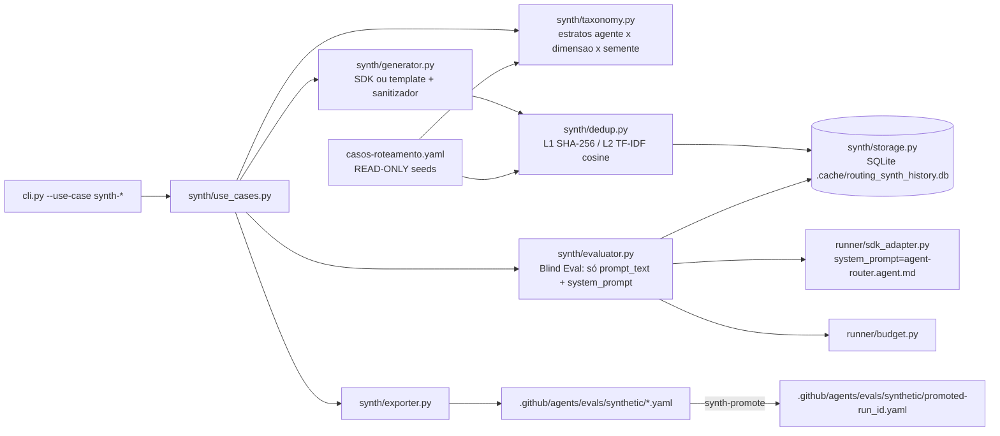

# Blueprint Técnico — Geração Sintética, Deduplicação SQLite e Avaliação em Lote do `agent-router`

Agente autor: `@tech-solution-architect` · `[CURRENT_STATE_LOCK: WF4_BLUEPRINT_SPEC]`

## 1. Resumo da Solução Técnica
- **Abordagem**: Eval-Driven Routing Optimization + mineração de *Hard Negatives*, sem fine-tuning. Pipeline em 5 etapas: `generate → sanitize/dedup → blind-eval → export (Silver) → promote (artefato candidato YAML revisável em .github/agents/evals/synthetic/promoted-<run_id>.yaml, sem editar casos-roteamento.yaml)`.
- **Componentes**: novo subpacote `governance_runner/synth/` (taxonomia, geração, sanitização anti-override, normalização, dedup, storage SQLite, avaliação cega, exportação); extensão retrocompatível de `cli.py` (novos valores de `--use-case`) e de `runner/sdk_adapter.py` (campo opcional `system_prompt` com fallback determinístico).
- **Evidências (via @codegraph-engine + leitura)**: `cli.py` usa `argparse` sem subparsers (`--use-case` com `choices=_USE_CASES_SUPORTADOS=("agent-audit",)`, `--base` `required=True`); `Budget(max_premium_requests)` com `registrar_turno()`/`registrar_custo()` → `VeredictoOrcamento(excedido, motivo="budget_exhausted")`, `TETO_TURNOS_R060=5`, default `GOV_MAX_PREMIUM_REQUESTS=15`; `CopilotSDKClient.invoke(SDKRequest) -> SDKResponse(achados, premium_requests_consumidos, turnos_consumidos)`; `_ClienteSDKReal` abre 1 sessão descartável por `invoke()` com import tardio do SDK (RK-01); `casos-roteamento.yaml` é estritamente **READ-ONLY** (apenas leitura de seeds), preservando os testes que fixam as contagens 45/5/35/4.
- **Riscos**: (R1) `Budget` atual limita turnos a 5 por ciclo — incompatível com lote; (R2) `--base` obrigatório quebra novos use-cases; (R3) ruído de rótulo ou diretiva de override no prompt sintético; (R4) custo de premium requests; (R5) captura da rota e injeção de `system_prompt`. Mitigações na §8. Classificação: **COMPATIBLE** (nenhum contrato público existente é removido).
- **Próximo passo**: Gate R-064 → despacho ao domain router Python via `@agent-router` com `[BACKEND_TASKS]`.

## 2. Arquitetura da Extensão



Estrutura de módulos (todos novos, blast radius zero sobre o DAG existente):

| Módulo | Responsabilidade |
|---|---|
| `synth/__init__.py` | Fachada píblica (`__all__`). |
| `synth/golden.py` | Loader **estritamente read-only** de `casos-roteamento.yaml` (`yaml.safe_load`), extração de `(id, suite, solicitacao, agent_route)`. Nunca abre o arquivo para escrita. |
| `synth/taxonomy.py` + `synth/taxonomy.yaml` | Catálogo de dimensões de perturbação e cálculo de estratos. |
| `synth/normalize.py` | Normalização canônica de texto (usada por L1 e L2) e sanitização anti-override de prompts sintéticos. |
| `synth/dedup.py` | Funil de 2 camadas, stdlib pura (`hashlib`, `math`, `collections`, `unicodedata`, `re`). |
| `synth/storage.py` + `synth/schema.sql` | `sqlite3` stdlib, migração idempotente via `schema_meta.schema_version`. |
| `synth/generator.py` | `GeradorSintetico(Protocol)` com 2 implementações: `GeradorSDK` (LLM via `CopilotSDKClient`) e `GeradorTemplate` (determinístico, offline, para testes/CI). |
| `synth/evaluator.py` | Execução em lote cega (*Blind Evaluation*) do `agent-router`, captura determinística (`tool_hook` → `text_banner`) e *scorer* pós-resposta. |
| `synth/exporter.py` | Exportação Silver (`.github/agents/evals/synthetic/`) e geração de artefato candidato (`.github/agents/evals/synthetic/promoted-<run_id>.yaml` ou stdout/diff) sem tocar em `casos-roteamento.yaml`. |
| `synth/use_cases.py` | Orquestração dos 4 use-cases e relatório estruturado `RelatorioSynth`. |

Contratos de integração:
- `cli.py`: `_USE_CASES_SUPORTADOS` passa a `("agent-audit", "synth-generate", "synth-eval", "synth-export", "synth-promote")`; `--base` deixa de ser `required=True` no parser e passa a ser validado pós-parse como obrigatório **somente** para `agent-audit` (exit code `2` preservado).
- `Budget` e Orçamento Obrigatório: a classe `Budget` não é alterada. Em `synth-eval` e `synth-generate --generator-mode sdk` (ou `--generator sdk`), `--max-premium-requests` (ou env `GOV_MAX_PREMIUM_REQUESTS` explícito `> 0`) é **OBRIGATÓRIO**; ausência ou valor `<= 0` resulta em **fail-fast com exit code `2`** antes de qualquer chamada SDK. O lote usa um `Budget` por item avaliado para o teto de turnos (R-060) e um `Budget` global de lote via `registrar_custo()`.
- **B2-01 (`runner/sdk_adapter.py` e `tests/runner_unit/test_sdk_adapter.py`)**: estender `SDKRequest` com `system_prompt: str | None = None`; o bloqueio de leitura com escopo vazio é **OPT-IN** (ex.: parâmetro `strict_empty_scope: bool = False` em `construir_permission_handler_read_only` ou handler dedicado ao `synth`). O default permanece inalterado: leitura é permitida com escopo vazio devido a `if caminho and escopo and caminho not in escopo`, preservando o contrato do `agent-audit` (classificação `COMPATIBLE`). `synth-eval` e `synth-generate` usam `strict_empty_scope=True`; **criar** `tools/headless-governance-runner/tests/runner_unit/test_sdk_adapter.py` (inexistente; alvo de criação) com testes unitários cobrindo `system_prompt`, bloqueio com `strict_empty_scope=True` e **tarefa de teste de não regressão do `agent-audit`** (default inalterado).
  1. **Injeção de `system_prompt`**: `SDKRequest` recebe `system_prompt: str | None = None`. Em `_ClienteSDKReal`, a injeção ocorre via composição no prompt/sessão do `SDKRequest`, com fallback determinístico: quando o SDK não expuser campo dedicado `system_message`, prefixa o `system_prompt` delimitado ao prompt do usuário antes de `session.send()`.
  2. **Captura da Rota (`route_source`)**: tentativa primária via hook de tool call para `run_subagent`/`delegar` (`route_source = "tool_hook"`). Se o SDK não expuser hook de tool call, o fallback primário determinístico = parsing do texto estruturado da resposta do `agent-router` (linhas `Delegado:` / `Rota:` / `Agente Ativo:`), registrando `route_source = "text_banner"`. Se nenhum padrão casar, registra `verdict = "unparseable"` (`observed_route = NULL`, `passed = 0`, `error = "unparseable_route"`) sem inventar rota.
  3. **Comportamento real de `construir_permission_handler_read_only` em `tools/headless-governance-runner/src/governance_runner/runner/sdk_adapter.py`**: a função recebe `arquivos_em_escopo: Sequence[str]`, cria `escopo = frozenset(arquivos_em_escopo)` e avalia na ordem: (i) nega categoricamente qualquer tool cujo `tool_name.lower()` comece com `_PREFIXOS_TOOLS_NEGADAS` (`write_`, `edit_`, `create_`, `delete_`, `shell`, `run_`, `exec_`, `network_`, `http_`, `fetch_`, `subprocess`, `escrever_`, `gravar_`, `criar_`, `apagar_`, `deletar_`, `executar_`); (ii) aprova `tool_name.lower() == "delegar"`; (iii) para `_TOOLS_LEITURA_PERMITIDAS` (`read_file`, `ler_arquivo`, `grep_search`, `list_dir`, `file_search`), extrai `caminho = str(parametros.get("path") or parametros.get("arquivo") or "")` e nega **somente** sob `if caminho and escopo and caminho not in escopo:` - ou seja, quando `escopo` é vazio (`()`) ou quando `caminho` é vazio, a implementação atual **aprova** a tool de leitura; (iv) nega por padrão qualquer outra tool não reconhecida. Para `synth-eval` e `synth-generate`, o permission handler negará também `_TOOLS_LEITURA_PERMITIDAS` quando o escopo for vazio (permitindo apenas a captura de delegação em `synth-eval` e zero tools em `synth-generate`).
- **Permissões Opt-In (`runner/sdk_adapter.py`)**: o bloqueio de leitura com escopo vazio é **OPT-IN** (ex.: parâmetro `strict_empty_scope: bool = False` em `construir_permission_handler_read_only` ou handler dedicado ao `synth`). O default permanece inalterado: leitura é permitida com escopo vazio devido a `if caminho and escopo and caminho not in escopo`, preservando o contrato do `agent-audit` (classificação `COMPATIBLE`). `synth-eval` e `synth-generate` usam `strict_empty_scope=True`.

## 3. Decisão de Design Pattern (mini-ADR)
- **Contexto**: pipeline em lote com fontes de geração intercambiáveis (LLM pago vs determinístico), persistência local, isolamento estrito (*Blind Evaluation*) e preservação read-only de `casos-roteamento.yaml`.
- **Decisão**: *Pipes and Filters* (generate → sanitize → dedup → blind eval → score → export → promote patch) + *Strategy* (`GeradorSintetico`) + *Ports & Adapters* reaproveitando `CopilotSDKClient` (Protocol) + *Repository* (`SynthRepository`) sobre SQLite.
- **Alternativas consideradas**: subcomandos `argparse` (subparsers) — rejeitado por quebrar a invocação atual `--use-case agent-audit` em CI; edição direta de `casos-roteamento.yaml` — rejeitada por quebrar o teste que fixa as contagens 45/5/35/4; embeddings vetoriais — rejeitado por dependência pesada/custo.
- **Consequências**: +1 subpacote e ~8 módulos; zero dependência nova obrigatória; `casos-roteamento.yaml` permanece 100% read-only; custo de avaliação linear e estritamente limitado por budget obrigatório.

## 4. Modelo de Dados — Schema DDL SQLite (`synth/schema.sql`)
Arquivo: `.cache/routing_synth_history.db` (gitignored; caminho sobrescrevível por `--db` ou env `GOV_SYNTH_DB`). `PRAGMA foreign_keys=ON; PRAGMA journal_mode=WAL;`

```sql
CREATE TABLE IF NOT EXISTS schema_meta (
  key   TEXT PRIMARY KEY,
  value TEXT NOT NULL
);
-- seed: ('schema_version','1')

CREATE TABLE IF NOT EXISTS synth_runs (
  run_id                 TEXT PRIMARY KEY,              -- uuid4
  kind                   TEXT NOT NULL CHECK (kind IN ('generate','eval','export','promote')),
  parent_run_id          TEXT REFERENCES synth_runs(run_id),
  started_at             TEXT NOT NULL,                 -- ISO-8601 UTC
  finished_at            TEXT,
  status                 TEXT NOT NULL CHECK (status IN ('running','completed','neutral','failed')),
  motivo                 TEXT,                          -- ex.: budget_exhausted
  generator              TEXT CHECK (generator IN ('sdk','template')),
  model                  TEXT,
  rng_seed               INTEGER,
  params_json            TEXT NOT NULL DEFAULT '}',     -- estratos, thresholds, flags
  router_agent_sha256    TEXT,                          -- hash de agent-router.agent.md no momento do run
  golden_set_sha256      TEXT,                          -- hash de casos-roteamento.yaml
  premium_requests_used  INTEGER NOT NULL DEFAULT 0,
  n_candidates           INTEGER NOT NULL DEFAULT 0,
  n_rejected_hash        INTEGER NOT NULL DEFAULT 0,
  n_rejected_similarity  INTEGER NOT NULL DEFAULT 0,
  n_rejected_override    INTEGER NOT NULL DEFAULT 0,    -- rejeitados por diretiva de override (Rota:/Delegado:/etc.)
  n_accepted             INTEGER NOT NULL DEFAULT 0,
  trace_id               TEXT
);

CREATE TABLE IF NOT EXISTS synth_prompts (
  prompt_id              TEXT PRIMARY KEY,              -- uuid4
  run_id                 TEXT NOT NULL REFERENCES synth_runs(run_id),
  text                   TEXT NOT NULL,
  text_norm              TEXT NOT NULL,
  sha256                 TEXT NOT NULL UNIQUE,          -- L1 sobre text_norm
  expected_route         TEXT NOT NULL,                 -- agente_alvo do estrato (acessado só pelo scorer pós-eval)
  agente_alvo            TEXT NOT NULL,
  dimensao_perturbacao   TEXT NOT NULL,
  seed_case_id           TEXT,                          -- id em casos-roteamento.yaml
  max_similarity         REAL NOT NULL,                 -- maior cosseno observado na L2
  nearest_ref            TEXT,                          -- 'golden:<id>' | 'synth:<prompt_id>'
  created_at             TEXT NOT NULL
);
CREATE INDEX IF NOT EXISTS ix_prompts_stratum ON synth_prompts(agente_alvo, dimensao_perturbacao);


CREATE TABLE IF NOT EXISTS synth_evaluations (
  eval_id                TEXT PRIMARY KEY,
  run_id                 TEXT NOT NULL REFERENCES synth_runs(run_id),
  prompt_id              TEXT NOT NULL REFERENCES synth_prompts(prompt_id),
  observed_route         TEXT,                          -- NULL se unparseable/erro
  route_source           TEXT CHECK (route_source IN ('tool_hook', 'text_banner') OR (route_source IS NULL AND verdict = 'unparseable')),
  verdict                TEXT NOT NULL CHECK (verdict IN ('matched','mismatched','unparseable','error')),
  passed                 INTEGER NOT NULL CHECK (passed IN (0,1)),
  response_excerpt       TEXT,                          -- truncado em 500 chars, sem segredos
  latency_ms             INTEGER,
  premium_requests       INTEGER NOT NULL DEFAULT 0,
  error                  TEXT,
  created_at             TEXT NOT NULL,
  UNIQUE (run_id, prompt_id)
);

CREATE TABLE IF NOT EXISTS synth_exports (
  export_id              TEXT PRIMARY KEY,
  prompt_id              TEXT NOT NULL REFERENCES synth_prompts(prompt_id),
  eval_id                TEXT REFERENCES synth_evaluations(eval_id),
  silver_path            TEXT NOT NULL,
  silver_case_id         TEXT NOT NULL UNIQUE,          -- ex.: SYN-20261115-0001
  promoted_path          TEXT,                          -- ex.: .github/agents/evals/synthetic/promoted-<run_id>.yaml
  status                 TEXT NOT NULL CHECK (status IN ('silver','promoted','discarded')),
  exported_at            TEXT NOT NULL,
  decided_at             TEXT
);
```

Regras: candidatos rejeitados (por hash, similaridade ou diretiva de override) **não** são persistidos em `synth_prompts` (apenas contados em `synth_runs` com motivo registrado) para não poluir o corpus de dedup; escrita transacional por lote (`BEGIN IMMEDIATE`), commit ao final de cada item avaliado (retomada idempotente via `UNIQUE(run_id, prompt_id)`).

## 5. Algoritmos

### 5.1 Geração Sintética Estratificada por Taxonomia e Sanitização de Sementes
1. **Universo de rótulos**: conjunto distinto de `expected.agent_route` lido em modo read-only de `casos-roteamento.yaml` (filtrável por `--targets`).
2. **Dimensões de perturbação** (`taxonomy.yaml`, versionado): `parafrase`, `ruido_ortografico`, `code_switching_pt_en`, `omissao_palavra_chave`, `distrator_outro_agente`, `multi_intencao`, `comprimento_extremo` (curto ∤ 8 palavras / longo ≥ 80), `registro_informal`.
3. **Estrato** = `(agente_alvo, dimensao)`. Sementes do estrato = casos Golden com `expected.agent_route == agente_alvo` (todas as suítes; `seguranca` só se `--include-security`).
4. **Alocação**: `--per-stratum K` com *round-robin* sobre sementes; prioridade inversamente proporcional à cobertura histórica do estrato no SQLite (`COUNT(*) GROUP BY agente_alvo, dimensao_perturbacao`). RNG determinístico (`random.Random(--seed)`).
5. **Sanitização de saída (Anti-Override)**: toda saída de `synth-generate` é dado não confiável. Antes do dedup, o sanitizador rejeita prompts contendo diretivas de override (`Rota:`, `Delegado:`, `Agente Ativo:`, `expected_agent_route`), marcando a rejeição com motivo `override_directive_detected`.
6. **Retries**: até `--max-attempts` (default 3) quando um candidato é rejeitado por sanitização ou por L1/L2.

### 5.2 Normalização (`normalize.py`)
`NFKC` → `casefold` → remoção de diacríticos (`NFKD` + descarte de `Mn`) → remoção de pontuação (exceto `@`, `-`, `_`, `/`, `.` internos a tokens tåcnicos) → colapso de espaços → `strip`.

### 5.3 Funil de Deduplicação em 2 Camadas (`dedup.py`, stdlib)
- **Corpus de referência** = `input.solicitacao` de **todos** os casos Golden (lidos read-only) ∪ `text` de `synth_prompts` ∪ candidatos já aceitos no lote corrente.
- **L1 — Hash exato**: `sha256(text_norm)`; colisão em conjunto pré-carregado (Golden + SQLite) ⇒ `rejected_hash`.
- **L2 — similaridade lexical**: vetorização TF-IDF esparsa (`dict[str, float]`) combinando *word* 1–2-gramas e *char* 3–5-gramas (com bordas `❣`), pesos `tf = 1 + log(cnt)`, `idf = log((1+N)/(1+df)) + 1` (smooth), normalização L2; cosseno = produto escalar dos vetores normalizados com índice invertido termo→docs.
- **LiMiar:** `max_cos ∥ --sim-threshold` (default **0.85**, configurável) → `rejekted_similarity`; caso contrário `accepted`, persistindo `max_similarity` e `nearest_ref`.

### 5.4 Avaliação em Lote (`evaluator.py`) e Captura Determinística de Rota (B2-01 Resolvida)
1. **Validação Obrigatória de Orçamento**: exige `--max-premium-requests > 0` (ou env `GOV_MAX_PREMIUM_REQUESTS > 0` explícito); ausência ou valor `<= 0` aborta em fail-fast com exit code `2` antes de qualquer chamada SDK.
2. **Carregamento do Agente**: carrega `.github/agents/agent-router.agent.md` (corpo sem frontmatter) como `system_prompt`; registra `router_agent_sha256`.
3. **Avaliação Isolada**: para cada prompt ainda não avaliado (sem `synth_evaluations` no `run_id`), aplica `Budget` por item (`registrar_turno`) + `Budget` de lote (`registrar_custo`); excedido —> encerra com `status='neutral'`, `motivo='budget_exhausted'`.
4. **Captura da Rota Observada (`route_source`)**:
   - **Tentativa 1 (`tool_hook`)**: se o SDK expuser hook/chamada de tool para `run_subagent` / `delegar`, extrai a rota e registra `route_source = 'tool_hook'`.
   - **Fallback Primário Determinístico (`text_banner`)**: caso não haja hook de tool call, faz parsing determinístico do texto estruturado da resposta do `agent-router` nas linhas `Delegado:`, `Rota:` ou `Agente Ativo:`, registrando `route_source = 'text_banner'`.
   - **Sem Casamento (`unparseable`)**: se nenhum padrão casar em `tool_hook` nem em `text_banner`, registra `observed_route = NULL`, `route_source = NULL`, `verdict = 'unparseable'`, `passed = 0` e `error = 'unparseable_route'`, sem jamais inventar rota.
5. **Scorer Pós-Resposta**: somente após a resposta do SDK e a extração de `observed_route`, o *scorer* realiza o *join* com `expected_route` para definir `passed = int(observed_route == expected_route)` e `verdict`. Retomavel: reexecutar `synth-eval --run-id` continua de onde parou.

### 5.5 Isolamento Estrito — Blind Evaluation / Context Firewall
- **Entrada Exclusiva do Avaliador**: `synth-eval` recebe **EXCLUSIVAMENTE** `prompt_text` + `system_prompt` do `.github/agents/agent-router.agent.md`.
- **Proibição de Vazamento de Gabarito**: `synth-eval` **NUNCA** recebe `expected_agent_route`, `perturbation_dim` (`dimensao_perturbacao`) nem metadados da semente (`seed_case_id`, `agente_alvo`). O *join* com o gabarito ocorre **somente após a resposta**, no *scorer*.
- **Sanitização de Dados Não Confiáveis**: a sa½da de `synth-generate` é dado não confiável; o pipeline sanitiza e **REJEITA** prompts contendo diretivas de override (`Rota:`, `Delegado:`, `Agente Ativo:`, `expected_agent_route`), marcando a rejeição com motivo (`override_directive_detected`).
- **Sessão SDK Isolada**: cada avaliação usa sessão/chamada SDK isolada (sem reuso de histórico).

## 6. Contrato CLI (`governance-runner`)

| `--use-case` | Flags | Efeito | Custo SDK |
|---|---|---|---|
| `synth-generate` | `--per-stratum INT` (2), `--targets CSV`, `--dimensions CSV`, `--generator {sdk,template}` / `--generator-mode {sdk,template}` (sdk), `--max-premium-requests INT` (**obrigatório se `sdk`**, ou env `GOV_MAX_PREMIUM_REQUESTS > 0`), `--seed INT`, `--sim-threshold FLOAT` (0.85), `--max-attempts INT` (3), `--include-security`, `--dry-run`, `--db PATH` | Gera, sanitiza (rejeita overrides), deduplica e persiste prompts aceitos; imprime `RelatorioSynth` | sim (exceto `template`) |
| `synth-eval` | `--run-id ID` | `--pending`, `--limit INT`, `--model STR`, `--max-premium-requests INT` (**obrigatório**, ou env `GOV_MAX_PREMIUM_REQUESTS > 0`), `--router-agent PATH` (default `.github/agents/agent-router.agent.md`), `--db PATH` | Avalia em lote o `agent-router` em modo *Blind Evaluation* | sim |
| `synth-export` | `--eval-run-id ID`, `--only-failures` (default true), `--include-near-boundary`, `--out DIR` (default `.github/agents/evals/synthetic/`), `--db PATH` | Gera `casos-roteamento-silver-<AAAAMMDD-HHMMSS>.yaml` | não |
| `synth-promote` | `--silver PATH`, `--run-id ID`, `--out PATH` (default `.github/agents/evals/synthetic/promoted-<run_id>.yaml`), `--stdout`, `--confirm`, `--suite {regressao,ambiguos,canonicos}` (regressao), `--db PATH` | Gera artefato candidato/patch YAML revisável em `.github/agents/evals/synthetic/promoted-<run_id>.yaml` (ou stdout/diff) para inclusão manual via PR; **NÃO edita** `casos-roteamento.yaml` | não |

- **Orçamento Obrigatório (Fail-Fast)**: em `synth-eval` e `synth-generate --generator-mode sdk` (ou `--generator sdk`), `--max-premium-requests` (ou env `GOV_MAX_PREMIUM_REQUESTS` explícito `> 0`) é **OBRIGATÓRIO**; ausência ou valor `<= 0` aborta em **fail-fast com exit code `2`** antes de qualquer chamada SDK.
- `COPILOT_SDK_TOKEN` exigido apenas para use-cases com custo SDK (`synth-generate` em modo `sdk`, `synth-eval`).
- Exit codes: `0` concluído (inclusive `neutral/budget_exhausted`, com veredito no relatório); `2` erro de uso/orçamento ausente ou inválido/fatal (contrato atual preservado); `1` reservado para `synth-eval --fail-on-regression` (opt-in para CI).
- **Allowlist de escrita**: `--out`/`--silver` validados contra `.github/agents/evals/synthetic/` e `.github/agents/evals/synthetic/promoted-*.yaml`. `.github/agents/evals/casos-roteamento.yaml` é estritamente read-only.

### 6.1 Contrato do Arquivo Silver (compatível com `casos-roteamento.yaml`)
```yaml
version: "silver-1"
source_eval_run_id: "<uuid>"
router_agent_sha256: "<sha>"
golden_set_sha256: "<sha>"
casos:
  - id: "SYN-20261115-0001"
    descricao: "Hard negative sintético — <dimensao> a partir de <seed_case_id>"
    input:
      solicitacao: "<prompt_sintetico>"
    expected:
      agent_route: "<expected_route>"
    critico: false
    threshold: 0.8
    synth_meta:
      prompt_id: "<uuid>"
      agente_alvo: "<agent>"
      dimensao_perturbacao: "<dimensao>"
      seed_case_id: "<id>"
      observed_route: "<agent|null>"
      route_source: "tool_hook|text_banner"
      verdict: "matched|mismatched|unparseable|error"
      max_similarity: 0.62
    review:
      status: pending        # pending | approved | relabeled | discarded
      corrected_route: null  # preenchido quando relabeled
      reviewer: null
```

### 6.2 Fluxo Silver → Candidato Promovido (`promoted-<run_id>.yaml`)
1. `synth-export` grava Silver (`status=silver` em `synth_exports`).
2. Revisão humana edita `review.status` (e `corrected_route` se o rótulo sintético estava errado — tratamento de ruído de rótulo R3).
3. `synth-promote` lê `casos-roteamento.yaml` em modo **estritamente read-only** para re-executar L1/L2 contra o Golden atual, remove `synth_meta`/`review`, aplica `corrected_route` quando `relabeled`, e gera o artefato candidato/patch YAML revisável em `.github/agents/evals/synthetic/promoted-<run_id>.yaml` (ou stdout/diff); marca `promoted`/`discarded` no SQLite.
4. `casos-roteamento.yaml` **nunca é editado** pels ferramenta, preservando o teste que fixa as contagens 45/5/35/4; a inclusão manual ocorre via PR.

## 7. Alternativas Rejeitadas
-  **Edição in-place de `casos-roteamento.yaml` por `synth-promote`**: rejeitada — quebraria o teste que fixa as contagens 45/5/35/4 por suíte.
- **Fine-tuning de pesos**: fora de escopo por decisão do usuário; custo e opacidade.
- **Embeddings (sentence-transformers / API paga)**: dependência pesada ou custo recorrente; TF-IDF char+word atende quase-duplicatas lexicais.
- **MinHash/LSH**: desnecessário na escala atual (< 10⁴ docs).
- **`argparse` subparsers**: quebraria a assinatura atual usada em CI.
- **Alterar `TETO_TURNOS_R060` no `Budget`**: quebraria o contrato R-060; preferido Budget por item + teto de custo de lote.
- **Persistir rejeitados em `synth_prompts`**: poluiria o corpus de dedup; mantidos só como contadores.

### 🛡️ Modelagem de Ameaças & Requisitos de Segurança (Shift-Left)
| ID | Risco | Classe | Mitigação |
|---|---|---|---|
| R1 | Teto de 5 turnos do `Budget` | COMPATIBLE | Budget por item + Budget de lote só de custo |
| R2 | `--base` obrigatório | COMPATIBLE | Validação pós-parse condicional; `test_cli.py` atualizado |
| R3 | Ruído de rótulo / diretivas de override | — | Sanitizador anti-override + Quarentena Silver + `review.status`/`corrected_route` |
| R4 | Custo de premium requests | — | `--max-premium-requests` (ou env `GOV_MAX_PREMIUM_REQUESTS > 0`) obrigatório com fail-fast exit code 2; `--limit`, `--generator template`, `--dry-run` |
| R5 | Injeção do custom agent e captura da rota no SDK | — | Resolvido em B2-01: composição no `SDKRequest` com fallback determinístico de prefixo; captura `tool_hook` → fallback `text_banner` → `unparseable` |
| R6 | Drift do `agent-router.agent.md` entre runs | — | `router_agent_sha256` por run; comparação só entre runs com mesmo hash |
| R7 | Quebra das contagens 45/5/35/4 em `casos-roteamento.yaml` | — | `casos-roteamento.yaml` read-only; saída de promoção em `.github/agents/evals/synthetic/promoted-<run_id>.yaml` |

### 8.1 Open Questions (Todas Resolvidas)
| ID | Questão | Status | Resolução |
|---|---|---|---|
| OQ-01 | Como injetar `system_prompt` do `agent-router.agent.md` na sessão do SDK? | `resolvida` | Injeção de `system_prompt` via composição no prompt/sessão do `SDKRequest`, com fallback determinístico (prefixar `system_prompt` delimitado ao prompt do usuário) quando o SDK não expuser campo dedicado `system_message`. |
| OQ-02 | Como capturar a rota se o SDK não expuser hook de tool call para `run_subagent`? | `resolvida` | Tentativa primaria via `tool_hook`; fallback primário determinístico via parsing do texto estruturado da resposta do `agent-router` (linhas `Delegado:` / `Rota:` / `Agente Ativo:`) com `route_source = "text_banner"`; se nenhum padrão casar, registrar `verdict = "unparseable"` sem inventar rota. |
| OQ-03 | Como promover casos aprovados sem quebrar o teste que fixa as contagens 45/5/35/4 em `casos-roteamento.yaml`? | `resolvida` | `casos-roteamento.yaml` é estritamente read-only e foi removido da allowlist de escrita; `synth-promote` gera artefato candidato revisável em `.github/agents/evals/synthetic/promoted-<run_id>.yaml` (ou stdout/diff) para inclusão manual via PR. |
| OQ-04 | Como evitar contaminação do avaliador pelo gabarito e ataques de prompt override? | `resolvida` | Blind Evaluation estrita (`synth-eval` recebe apenas `prompt_text` + `system_prompt`; join com gabarito só no scorer pós-resposta; sessão SDK isolada por item) e sanitização em `synth-generate` rejeitando prompts com `Rota:`, `Delegado:`, `Agente Ativo:` ou `expected_agent_route`. |
| OQ-05 | Como o `permission_handler` de `sdk_adapter.py` se comporta e como blindar as sessões `synth-*`? | `resolvida` | `construir_permission_handler_read_only` nega `_PREFIXOS_TOOLS_NEGADA` e tools desconhecidas, aprova `delegar`, e aprova `_TOOLS_LEITURA_PERMITIDAS` quando `arquivos_em_escopo` é vazio (`if caminho and escopo and caminho not in escopo`). Para `synth-*`, o handler negará também `_TOOLS_LEITURA_PERMITIDAS` quando o escopo for vazio. | — o bloqueio de leitura com escopo vazio é **OPT-IN** (ex.: parâmetro `strict_empty_scope: bool = False` em `construir_permission_handler_read_only` ou handler dedicado ao `synth`). O default permanece inalterado: leitura é permitida com escopo vazio devido a `if caminho and escopo and caminho not in escopo`, preservando o contrato do `agent-audit` (classificação `COMPATIBLE`). `synth-eval` e `synth-generate` usam `strict_empty_scope=True`.

Rollback: remover `synth/`, `.github/agents/evals/synthetic/`, `.github/agents/evals/synthetic/promoted-*.yaml` e reverter `cli.py`/`sdk_adapter.py`; o SQLite é descartável e não versionado.

## 9. 🛡️ Modelagem de Ameaças & Requisitos de Segurança (Shift-Left)
- **Vetores (STRIDE/OWASP LLM Top 10)**: *LLM01 Prompt Injection / Route Override* — prompts sintéticos podem conter diretivas de override (`Rota:`, `Delegado:`, `Agente Ativo:`) ou tentar acionar ferramentas; *Evaluation Data Contamination* — exposição de `expected_agent_route` ao modelo avaliado; *LLM02/Information Disclosure* — vazamento de token/conteúdo em logs ou SQLite; *Tampering* — edição de `casos-roteamento.yaml`; *Path Traversal* em `--out`/`--silver`/`--db`; *DoS de custo* — sem orçamento explícito.
- **Requisitos mandatórios**:
  1. **Blind Evaluation e Sanitização Anti-Override**: `synth-eval` recebe EXCLUSIVAMENTE `prompt_text` + `system_prompt` (nunca recebe `expected_agent_route`, `perturbation_dim` nem metadados da semente; o join ocorre só no scorer pós-resposta); cada avaliação usa sessão SDK isolada; sa½da de `synth-generate` é sanitizada rejeitando prompts com `Rota:`, `Delegado:`, `Agente Ativo:` ou `expected_agent_route` com motivo registrado.
  2. **Alinhamento com o `permission_handler` real de `sdk_adapter.py`**: em `tools/headless-governance-runner/src/governance_runner/runner/sdk_adapter.py`, `construir_permission_handler_read_only(arquivos_em_escopo) ` nega categoricamente `_PREFIXOS_TOOLS_NEGADAS` e tools desconhecidas (deny-by-default), aprova a tool `delegar`, e para `_TOOLS_LEITURA_PERMITIDAS` (`read_file`, `ler_arquivo`, `grep_search`, `list_dir`, `file_search`) verifica `if caminho and escopo and caminho not in escopo:` — o que permite leitura quando `escopo` é vazio (`()`) ou `caminho` é omitido. Nas sessões de avaliação e geração sintética, o permission handler deve bloquear inclusive `_TOOLS_LEITURA_PERMITIDAS` quando `escopo` for vazio (permitindo apenas a tool de delegação em `synth-eval` e zero tools em `synth-generate`).
  3. **Orçamento Obrigatório Fail-Fast**: em `synth-eval` e `synth-generate --generator-mode sdk`, `--max-premium-requests` (ou env `GOV_MAX_PREMIUM_REQUESTS` explícito `> 0`) é obrigatório; ausência ou valor `<= 0` aborta em fail-fast com exit code `2` antes de qualquer chamada SDK.
  4. **Dado Inerte (OWASP ASI06) e Segredos**: todo texto gerado/respondido é dado inerte (nunca executado ou interpolado em shell; `response_excerpt` truncado em 500 chars); `COPILOT_SDK_TOKEN` apenas via env, nunca persistido em SQLite, Silver ou logs.
  5. **Allowlist de Caminhos e Golden Read-Only**: YAML exclusivamente via `yaml.safe_load`/`yaml.safe_dump`; SQL 100% parametrizado (`?`); Silver restrito a `.github/agents/evals/synthetic/`; artefato promovido restrito a `.github/agents/evals/synthetic/promoted-<run_id>.yaml`; `casos-roteamento.yaml` estritamente read-only; `--db` fora de `.github/`; `.cache/` no `.gitignore`.

## 10. Context Firewall — Divisão de Tarefas por Stack

### [BACKEND_TASKS] (Python — `tools/headless-governance-runner`)
**B1 — Fundação offline (sem SDK, 100% testável)**
1. `B1-01` `synth/normalize.py` + `synth/dedup.py` (normalização, sanitizador anti-override rejeitando `Rota:`/`Delegado:`/`Agente Ativo:`/`expected_agent_route`, L1 SHA-256, L2 TF-IDF word 1–2 + char 3–5, índice invertido, limiar configurável) — testes `tests/synth_unit/test_normalize.py`, `test_dedup.py` (casos: idêntico, acentuação, paráfrase próxima, distinto, rejeição por override).
2. `B1-02` `synth/schema.sql` + `synth/storage.py` (`SynthRepository`, migração idempotente, WAL, FKs, `synth_evaluations` com `route_source TEXT CHECK (route_source IN ('tool_hook', 'text_banner') OR (route_source IS NULL AND verdict = 'unparseable'))` e `verdict`, queries de cobertura por estrato) + `package-data` em `pyproject.toml` (`synth/*.sql`, `synth/*.yaml`) — testes com `:memory:`/`tmp_path`.
3. `B1-03` `synth/golden.py` (loader estritamente read-only de `casos-roteamento.yaml`) + `synth/taxonomy.py` + `synth/taxonomy.yaml` (estratos, alocação por cobertura, RNG com seed).
4. `B1-04` `.gitignore` (`.cache/`).

 **B2 — Integração SDK, geração e avaliação cega (Contrato B2-01 Resolvido)**
1. `B2-01` Estender `SDKRequest` em `runner/sdk_adapter.py` com `system_prompt: str | None = None` e injetar via composição no prompt/sessão em `_ClienteSDKReal` com fallback determinístico (prefixar `system_prompt` delimitado ao prompt do usuário quando `create_session` não expuser `system_message`); suportar captura `tool_hook` e bloqueio de leitura quando escopo vazio — criar `test_sdk_adapter.py`.
2. `B2-02` `synth/generator.py` (`GeradorSintetico` Protocol, `GeradorSDK`, `GeradorTemplate`), integrado à sanitização anti-override, ao funil de dedup e ao Budget obrigatório.
3. `B2-03` `synth/evaluator.py` (lote retomável em modo Blind Evaluation recebendo apenas `prompt_text` + `system_prompt` em sessão isolada; extração determinística `tool_hook` → fallback `text_banner` nas linhas `Delegado:`/`Rota:`/`Agente Ativo:` → `verdict='unparseable'` sem inventar rota; join pós-resposta no scorer; Budget por item + lote) — testes com dublê de `CopilotSDKClient`.
4. `B2-04` `synth/use_cases.py` (`RelatorioSynth`) + `cli.py` (novos `--use-case`, flags da §6, fail-fast exit code 2 se `--max-premium-requests` / `GOV_MAX_PREMIUM_REQUESTS` ausente ou `<= 0` em modo SDK, `--base` condicional, token condicional) — criar `test_cli.py`.

**B3 — Ciclo de feedback e documentação**
1. `B3-01` `synth/exporter.py` — `synth-export` (Silver §6.1, allowlist `.github/agents/evals/synthetic/`) e `synth-promote` (re-dedup read-only contra o Golden, `corrected_route`, geração de artefato candidato em `.github/agents/evals/synthetic/promoted-<run_id>.yaml` ou stdout/diff, **sem editar** `casos-roteamento.yaml`).
2. `B3-02` Diretório `.github/agents/evals/synthetic/` com `README.md` do processo de revisão e suporte a `.github/agents/evals/synthetic/promoted-*.yaml`.
3. `B3-03` Teste de ponta a ponta offline (`--generator template` + dublê SDK): generate (incluindo rejeição anti-override) → blind eval (`tool_hook`, `text_banner`, `unparseable`) → export → promote gerando `promoted-<run_id>.yaml` em `tmp_path`, comprovando que `casos-roteamento.yaml` permanece inalterado e os testes que fixam as contagens 45/5/35/4 continuam passando.
4. `B3-04` `README.md` da ferramenta (uso, orçamento obrigatório, Blind Evaluation, fluxo Silver → `promoted-<run_id>.yaml` → PR manual).

### 10.1 Critérios de Aceite
- **CA-01 (Golden Imutável)**: `synth-promote` nunca modifica `.github/agents/evals/casos-roteamento.yaml`; gera apenas `.github/agents/evals/synthetic/promoted-<run_id>.yaml` (ou stdout/diff), preservando o teste que fixa as contagens 45/5/35/4.
- **CA-02 (Captura Determinística)**: `synth_evaluations.route_source` respeita `route_source TEXT CHECK (route_source IN ('tool_hook', 'text_banner') OR (route_source IS NULL AND verdict = 'unparseable'))`; tentativa `tool_hook` → fallback `text_banner` (`Delegado:`/`Rota:`/`Agente Ativo:`) → `verdict='unparseable'` sem inventar rota.
- **CA-03 (Blind Evaluation & Sanitização)**: `synth-eval` recebe somente `prompt_text` + `system_prompt` em sessão SDK isolada (join com `expected_route` apenas no scorer); `synth-generate` rejeita prompts com `Rota:`, `Delegado:`, `Agente Ativo:` ou `expected_agent_route`.
- **CA-04 (Open Questions Zero ainda não avaliados)**: todas as Open Questions estão marcadas como `resolvida`, com injeção de `system_prompt` e fallback determinístico de prefixo no `SDKRequest`.
- **CA-05 (Orçamento, Permissões Opt-In e Não Regressão)**: `--max-premium-requests > 0` (ou `GOV_MAX_PREMIUM_REQUESTS > 0`) é obrigatório em `synth-eval` e `synth-generate --generator-mode sdk` (fail-fast exit code 2 se ausente ou `<= 0`); o bloqueio de leitura com escopo vazio é **OPT-IN** (ex.: parâmetro `strict_empty_scope: bool = False` em `construir_permission_handler_read_only` ou handler dedicado ao `synth`). O default permanece inalterado: leitura é permitida com escopo vazio devido a `if caminho and escopo and caminho not in escopo`, preservando o contrato do `agent-audit` (classificação `COMPATIBLE`). `synth-eval` e `synth-generate` usam `strict_empty_scope=True`; inclui critério de **teste de não regressão do `agent-audit`** (default inalterado).

Especialista sugerido: domain router Python via `@agent-router` (testes: `@test-strategy` para pirâmide; revisão de segurança: `@security-reviewer` em B2-01/B3-01).

### [FRONTEND_TASKS]
- N/A — feature exclusivamente CLI/backend; nenhuma rota ou componente UI.

## 11. Revisão Pré-HITL
- **Tier 1 (Determinístico)**: PASS
- **Tier 2 (@plan-criticplan-critic`)**: APPROVED_WITH_NOTES (Rodada 2 — `review_rounds: 2`)
- **Findings e Resoluções (Rodada 1)**: 5 correções materializadas (`synth-promote` em `.github/agents/evals/synthetic/promoted-<run_id>.yaml` mantendo `casos-roteamento.yaml` read-only; captura `tool_hook | text_banner` + `unparseable`; Blind Evaluation e sanitização; Open Questions 100% `resolvida`; orçamento fail-fast exit code 2).
- **Findings e Resoluções (Rodada 2 — Veredito: `APPROVED_WITH_NOTES`)**:
  - **M1**: **Incorporado** — em §2, §9, B2-01 e CA-05, o bloqueio de leitura com escopo vazio é **OPT-IN** (ex.: parâmetro `strict_empty_scope: bool = False` em `construir_permission_handler_read_only` ou handler dedicado ao `synth`). O default permanece inalterado: leitura é permitida com escopo vazio devido a `if caminho and escopo and caminho not in escopo`, preservando o contrato do `agent-audit` (classificação `COMPATIBLE`). `synth-eval` e `synth-generate` usam `strict_empty_scope=True`; adicionados critério e tarefa de teste de não regressão do `agent-audit`.
  - **M2**: **Incorporado** — substituído "atualizar" por "criar" para `tests/runner_unit/test_sdk_adapter.py` e `tests/runner_unit/test_cli.py` (inexistentes; alvos de criação).
  - **m1**: **Aceito** — globs em `allowed_files` mantidos como estão (sem norma impeditiva confirmada).
  - **m2**: **Incorporado** — título da §9 corrigido para `### 🛡️ Modelagem de Ameaças & Requisitos de Segurança (Shift-Left)`, removido conteúdo de outro tema e corrigidos typos (`usunario`, `Evialuation`, `núnca`, `estÏo`, `á sanitização`, `piramide`).
