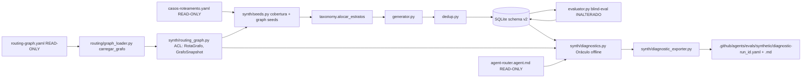

# Blueprint Técnico (Delta) — Integração do `routing-graph.yaml` ao Pipeline `synth` (Geração + Diagnóstico de Assertividade)

Agente autor: `@tech-solution-architect` · `[CURRENT_STATE_LOCK: WF4_BLUEPRINT_SPEC]` · Delta sobre `20261115-100000-synth-routing-eval-sqlite.md`

## 1. Resumo da Solução Técnica
- **Abordagem**: Anti-Corruption Layer read-only sobre o `routing.graph_loader` existente + Coverage-Guided Seeding (sementes graph-seeded só para arestas com cobertura Golden abaixo do mínimo) + Oráculo offline determinístico (`synth-diagnose`, 0 premium requests) que cruza avaliações do blind-eval com o grafo e com o texto do `agent-router.agent.md`.
- **Componentes**: novo `synth/routing_graph.py`, novo `synth/seeds.py`, novo `synth/diagnostics.py`, novo `synth/diagnostic_exporter.py`; evolução de `golden.py` (campos opcionais), `taxonomy.py`, `generator.py`, `storage.py`/`schema.sql` (schema v2), `use_cases.py`, `cli.py` (`--use-case synth-diagnose` + flags de geração).
- **Evidências (@codegraph-engine + leitura)**: `routing-graph.yaml` com 48 nós (`nos:`), `workflows:`, `arestas:` (campos `de`, `para`, `prioridade`, `threshold_score`, `nivel_routing`, `condicoes{tipo, regra, keywords[], sinal_r006, gatilho, fast_path_bypass}`), `politica_cascata:`; Contrato/validação canônica: `routing/graph_loader.py::carregar_grafo` (fonte única de verdade; o synth reutiliza o loader, sem schema JSON paralelo; RG-01 `tipo` default `keyword_based`); `schema.sql` v1 (`synth_runs.kind CHECK(generate|eval|export|promote)`, `prompts`/`synth_prompts`, `synth_evaluations`, `synth_exports`); `golden.py::CONTAGENS_ESPERADAS_POR_SUITE={45,5,35,4}` fixado em `tests/synth_unit/test_golden.py` e `test_taxonomy.py` (`85*5`).
- **Riscos**: RK-G1 quebra das contagens 45/5/35/4 → mitigado: Golden intocado, graph-seeding aditivo e opt-in (`--graph-seeding off` por padrão); RK-G2 `ALTER TABLE` e índices em SQLite → migração atômica v1→v2 via `BEGIN IMMEDIATE` e `PRAGMA user_version`, com `ALTER TABLE` via `conn.execute(...)` individual antes da criação de índice (proibido `executescript`); RK-G3 vazamento do grafo para o modelo avaliado → blind-eval inalterado (o avaliador `synth-eval` recebe exclusivamente `{prompt_text, system_prompt}`); RK-G4 múltiplas arestas para o mesmo `para` (ex.: `tech-solution-architect` via `security_gate` e `fallback`) → `edge_id` determinístico por hash canônico e independente da ordem do YAML.

## 2. Blueprint Técnico


### 2.1 `synth/routing_graph.py` (ACL read-only)
- **Contrato/validação canônica**: `routing/graph_loader.py::carregar_grafo` (fonte única de verdade; o synth reutiliza o loader, sem schema JSON paralelo; `caminho_schema` de `carregar_grafo(caminho_yaml, caminho_schema)` = schema empacotado em `routing/`, resolvido via `Path(routing.__file__).parent`; nunca fornecido pelo usuário (fecha o vetor de path em `--routing-graph`)). Complementa com `yaml.safe_load` do mesmo arquivo apenas para campos não expostos pelo modelo `Grafo` (keywords, `sinal_r006`, `regra`, `nivel_routing`) — nunca abre em modo escrita.
- Tipos: `RotaGrafo(edge_id, de, para, tipo, regra, prioridade, threshold_score, nivel_routing, keywords: tuple[str,...], sinal_r006: str|None)`; `GrafoSnapshot(sha256, rotas: tuple[RotaGrafo,...], nos: frozenset[str])`.
- API: `carregar_snapshot_grafo(path=None, *, repo_root) -> GrafoSnapshot`; `rotas_validas(snapshot, *, incluir_tipos=...) -> tuple[RotaGrafo,...]`; `resolver_aresta(expected_route, prompt_norm, snapshot) -> tuple[str|None, Literal['keyword','unique_target','priority','orphan']]`.
- **Rota válida**: `de == "agent-router"`, `para` ∈ `nos`, `para != "agent-router"`, arestas `health_check` e `mandatory_pre_step` **EXCLUÍDAS** das rotas válidas; `security_gate` **incluída** (coberto por CA-02).
- **`edge_id` determinístico e independente da ordem do YAML**: `edge_id = "e-" + sha256(canonical_json([de, para, prioridade, condicoes.tipo, discriminador]))[:12]` onde `discriminador = condicoes.regra` se presente, senão `sha256("\n".join(sorted(keywords normalizados lower/strip)))`. `canonical_json = json.dumps(..., sort_keys=True, separators=(",",":"), ensure_ascii=False)`. Colisão residual → falha explícita (`ValueError` com as duas arestas), nunca sufixo por índice de posição (coberto por CA-03).
- Keywords normalizadas via `normalize.normalizar`; matching **literal** (substring em texto normalizado) — proibido compilar regex a partir do YAML (anti-ReDoS).

### 2.2 `synth/seeds.py` (Coverage-Guided Seeding)
- `SeedRef(prompt, expected_route, seed_case_id, seed_source: Literal['manual','routing_graph'], graph_edge_id: str|None, keywords: tuple[str,...])`. `GoldenSeed` ganha campos opcionais `seed_source='manual'`, `graph_edge_id=None` (retrocompatível; `test_golden.py` intacto).
- `calcular_cobertura_golden(golden_seeds, snapshot) -> dict[edge_id, int]` (resolução via `resolver_aresta`).
- `gerar_seeds_grafo(snapshot, cobertura, *, min_cobertura=3, modo: 'off'|'gaps'|'all') -> tuple[SeedRef,...]`: para cada aresta válida com cobertura < `min_cobertura` (ou todas em `all`), emite `k = min_cobertura - cobertura` seeds determinísticas; `prompt` = template neutro em PT-BR a partir de 1–2 keywords (escolha por `rng_seed`) + `sinal_r006` como contexto inerte de geração (nunca como diretiva); `seed_case_id = "graph:{edge_id}:{i}"`; passa por `normalize.sanitizar_prompt`.
- Arestas sem keywords (ex.: tipo puramente por gatilho) → seed derivado de `gatilho`/`descricao` do nó; se vazio → registrado como `uncoverable` no diagnóstico (não falha).
- Garantia: em `modo == 'off'` (default), gera zero prompts do grafo; em `modo == 'gaps'`, só cobre arestas sem prompt/abaixo do mínimo (coberto por CA-01).

### 2.3 Evolução de geração
- `taxonomy.alocar_estratos` aceita `Sequence[SeedRef | GoldenSeed]` (Protocol `SeedLike`); estratos passam a `agente_alvo × dimensao × seed_source`; `cobertura_historica` mantém chave `(agente, dimensao)` (compatível).
- `GeradorTemplate`/`GeradorSDK` propagam `seed_source`/`graph_edge_id`; `GeradorSDK` recebe keywords como "tema", com sanitizador anti-override aplicado na saída.
- Prompts manuais/Golden também recebem `graph_edge_id` resolvido (rastreabilidade bidirecional).

### 2.4 Oráculo `synth/diagnostics.py` (offline, 0 premium requests)
Entrada: `eval_run_id`, `GrafoSnapshot`, texto do `agent-router.agent.md`. Saída: `DiagnosticoAssertividade` (dataclass imutável, ordenação determinística).
1. **Métricas por aresta e por nó**: suporte, TP, FN, FP (observado = `para` mas esperado ≠), precision, recall, F1, taxa `unparseable`, segmentadas por `seed_source`.
2. **Matriz de confusão** `expected_route × observed_route` (inclui `<unparseable>`).
3. **Rotas órfãs**: arestas válidas com 0 casos Golden; arestas com 0 avaliações; `uncoverable`.
4. **Colisões estáticas**: keyword normalizada presente em ≥2 arestas com `para` distintos; sobreposição por substring; mesmo `prioridade` com keywords sobrepostas.
5. **Divergência grafo × router.md**: nós `para` não mencionados (`@<id>`) no `agent-router.agent.md`; agentes citados no `.agent.md` ausentes em `nos`; rotas observadas fora de `nos` ("rotas fantasma").
6. **Sugestões acionáveis** (regras determinísticas, nunca aplicadas): `SUG-KW-ADD` (n-grams frequentes em FN ausentes das keywords da aresta esperada), `SUG-KW-COLLISION`, `SUG-DISAMBIG` (par A→B com confusão ≥ `--min-support`, propõe regra de desambiguação no `.agent.md` e ajuste de `prioridade`), `SUG-GOLDEN-GAP` (propor caso Silver para aresta órfã via `synth-export`), `SUG-ROUTER-DOC`, `SUG-GRAPH-PHANTOM`. Cada sugestão: `id, codigo, severidade(alta|media|baixa), alvo_arquivo, alvo_ancora, evidencias[prompt_id], proposta_texto`.

## 3. Decisão de Design Pattern (mini-ADR)
- **Contexto**: precisar dos campos do grafo sem acoplar `synth` à estrutura interna de `routing.model` nem duplicar validação.
- **Decisão**: Anti-Corruption Layer (`routing_graph.py`) reutilizando `routing/graph_loader.py::carregar_grafo` + Strategy para modo de seeding (`off|gaps|all`) + Oráculo como função pura sobre snapshot do SQLite (Pipes & Filters).
- **Alternativas consideradas**: parser YAML próprio (duplicaria a validação canônica de `routing/graph_loader.py::carregar_grafo`); estender `routing.model` (blast radius no runner de auditoria); diagnóstico embutido em `synth-eval` (misturaria custo SDK com análise offline e impediria re-diagnóstico sem nova avaliação).
- **Consequências**: +2 módulos e 1 use-case; diagnóstico re-executável idempotentemente sobre qualquer `eval_run_id`; dependência unidirecional `synth → routing` (sem ciclo).

## 4. Contratos e Interfaces (Spec-First)

### 4.1 CLI (retrocompatível)
```text
--use-case synth-generate  [+ --routing-graph PATH (default .github/agents/routing-graph.yaml)]
                           [+ --graph-seeding {off,gaps,all} (default: off)]
                           [+ --graph-min-coverage INT (default 3)]
--use-case synth-diagnose  --eval-run-id RUN_ID
                           [--routing-graph PATH] [--router-agent PATH]
                           [--min-support INT (default 2)] [--out DIR / --out-dir DIR (default .github/agents/evals/synthetic)]
                           [--format {yaml,md,both} (default both)] [--allow-root]
Exit codes: 0 ok | 2 orçamento inválido (inalterado) | 3 eval_run_id inexistente/não-eval | 4 routing-graph inválido (GraphValidationError) | 5 path fora do diretório permitido ou arquivo em denylist
```

### 4.2 Migração SQLite v1→v2 (atômica e idempotente)
A migração do schema SQLite v1→v2 DEVE obedecer estritamente a esta ordem e semântica:
- `conn.isolation_level = None`; `conn.execute("BEGIN IMMEDIATE")`;
- verificar `PRAGMA user_version` (`== 1` senão no-op/idempotente);
- `ALTER TABLE prompts ADD COLUMN seed_source TEXT NOT NULL DEFAULT 'manual'` (CHECK lógico: valores `manual|routing_graph` validados na aplicação);
- `ALTER TABLE prompts ADD COLUMN graph_edge_id TEXT NULL`;
- `ALTER TABLE prompts ADD COLUMN graph_edge_resolution TEXT NULL`;
- `ALTER TABLE synth_runs ADD COLUMN routing_graph_sha256 TEXT NULL`;
- criar tabelas auxiliares `routing_graph_edges` e `synth_diagnostics` se não existirem;
- **SOMENTE DEPOIS**: `CREATE INDEX IF NOT EXISTS ix_prompts_graph_edge ON prompts(graph_edge_id)`;
- `PRAGMA user_version = 2`; `COMMIT`; em exceção `ROLLBACK` e re-raise.
- **Nota explícita**: cada DDL via `conn.execute(...)` individual; **PROIBIDO** `executescript` (faz `COMMIT` implícito e quebra atomicidade do DDL).

```sql
ALTER TABLE prompts ADD COLUMN seed_source TEXT NOT NULL DEFAULT 'manual';
ALTER TABLE prompts ADD COLUMN graph_edge_id TEXT NULL;
ALTER TABLE prompts ADD COLUMN graph_edge_resolution TEXT NULL;
ALTER TABLE synth_runs ADD COLUMN routing_graph_sha256 TEXT NULL;
CREATE TABLE IF NOT EXISTS routing_graph_edges (snapshot_sha256 TEXT NOT NULL, edge_id TEXT NOT NULL, de TEXT NOT NULL, para TEXT NOT NULL, tipo TEXT NOT NULL, regra TEXT, prioridade REAL, threshold_score REAL, nivel_routing TEXT, keywords_json TEXT NOT NULL DEFAULT '[]', valida INTEGER NOT NULL CHECK (valida IN (0,1)), PRIMARY KEY (snapshot_sha256, edge_id));
CREATE TABLE IF NOT EXISTS synth_diagnostics (diagnostic_id TEXT PRIMARY KEY, eval_run_id TEXT NOT NULL REFERENCES synth_runs(run_id), routing_graph_sha256 TEXT NOT NULL, router_agent_sha256 TEXT, golden_set_sha256 TEXT, created_at TEXT NOT NULL, yaml_path TEXT, md_path TEXT, metrics_json TEXT NOT NULL, n_suggestions INTEGER NOT NULL DEFAULT 0);
CREATE INDEX IF NOT EXISTS ix_prompts_graph_edge ON prompts(graph_edge_id);
PRAGMA user_version = 2;
```

### 4.3 Artefato `diagnostic-<eval_run_id>.yaml` e `.md` (contrato e determinismo bit-a-bit)
```yaml
diagnostic_version: 1
diagnostic_id: string
eval_run_id: string
finished_at: string
hashes: {routing_graph_sha256: str, router_agent_sha256: str, golden_set_sha256: str}
resumo: {total_avaliacoes: int, acuracia_global: float, cobertura_arestas_golden: float, cobertura_arestas_total: float}
por_aresta:
  - {edge_id: str, para: str, tipo: str, suporte: {manual: int, routing_graph: int},
     tp: int, fp: int, fn: int, precision: float|null, recall: float|null, f1: float|null, unparseable: int}
matriz_confusao: {"<expected>": {"<observed>": int}}
orfas: {sem_golden: [edge_id], sem_avaliacao: [edge_id], uncoverable: [edge_id]}
colisoes: [{keyword_norm: str, edges: [edge_id], tipo: exata|substring}]
divergencias_router_md: {nos_nao_citados: [str], citados_fora_do_grafo: [str], rotas_fantasma: [str]}
sugestoes:
  - {id: SUG-0001, codigo: SUG-KW-ADD|SUG-KW-COLLISION|SUG-DISAMBIG|SUG-GOLDEN-GAP|SUG-ROUTER-DOC|SUG-GRAPH-PHANTOM,
     severidade: alta|media|baixa, alvo_arquivo: str, alvo_ancora: str, evidencias: [prompt_id], proposta_texto: str}
aviso: "Artefato consultivo (HITL). Nenhum arquivo-alvo é modificado automaticamente."
```
Regras de **determinismo bit-a-bit** de `diagnostic-<run_id>.yaml` e `.md` (coberto por CA-05):
- timestamp único derivado de `synth_runs.finished_at` do `eval_run_id` (nunca `datetime.now()`); sem hostname/paths absolutos/PID/duração no corpo;
- ordenação lexicográfica estável: chaves (`sort_keys=True`), arestas por `edge_id`, listas por chave primária explícita;
- floats arredondados com `round(x, 6)` e serializados com precisão fixa; `null` em divisão por zero;
- escrita com `open(path, "w", encoding="utf-8", newline="\n")`; YAML via `yaml.safe_dump(sort_keys=True, allow_unicode=True, default_flow_style=False)`. O `.md` é renderização determinística do mesmo modelo.

### 4.4 Blind Evaluation (Contrato de Isolamento)
- O avaliador `synth-eval` recebe exclusivamente `{prompt_text, system_prompt}`; metadados do grafo ficam só no SQLite e no diagnóstico pós-avaliação (coberto por CA-06).

## 5. Alternativas Rejeitadas
- **Escrever automaticamente em `routing-graph.yaml`/`agent-router.agent.md`**: viola HITL e R-054 (mudança de comportamento em runtime sem revisão).
- **Graph-seeding ligado por default**: alteraria volume do E2E e cobertura histórica existente; mantido opt-in (`off`) por padrão.
- **Recriar `synth_runs` para incluir `kind=diagnose`**: rebuild de tabela com FKs em SQLite é arriscado; substituído por `synth_diagnostics`.
- **Injetar grafo no prompt do blind-eval**: contaminaria a avaliação cega.
- **Similaridade semântica via embeddings para colisões**: nova dependência e não-determinismo; usar matching literal normalizado.

## 6. 🛡️ Modelagem de Ameaças & Requisitos de Segurança (Shift-Left)
- **Path Traversal (STRIDE: Tampering) em `--out` e `--routing-graph`**: `Path.resolve(strict=False)` + `is_relative_to(repo_root)` (`out` restrito a `.synth/` ou diretório permitido `.github/agents/evals/synthetic/`); rejeitar symlinks que escapem; erro sem eco do path bruto (coberto por CA-07).
- **Prompt Injection via sementes do grafo (OWASP LLM01)**: keywords/regras do YAML tratadas como dados inertes; delimitação e escaping no template de geração; limite de tamanho por semente; strip de caracteres de controle; nunca concatenar instruções do YAML ao system prompt (`sanitizar_prompt` em todas as seeds graph-seeded).
- **Denylist imutável de escrita (vale MESMO com `--allow-root`)**: `.github/agents/routing-graph.yaml`, `.github/agents/agent-router.agent.md`, `.github/agents/evals/casos-roteamento.yaml` — comparação por path resolvido (case-insensitive no Windows); violação → abort com código de saída ≠ 0 (coberto por CA-07).
- **Information Disclosure**: diagnóstico sem segredos/env vars; escape de `|`, backticks e `<` em excertos no `.md` e truncamento a 240 chars.

## 7. Context Firewall — Divisão de Tarefas por Stack

#### [BACKEND_TASKS]
**B1 — Fundação (ingestão + schema v2)**
1. `B1-01` Criar `synth/routing_graph.py` (ACL sobre `routing/graph_loader.py::carregar_grafo`, onde `caminho_schema` de `carregar_grafo(caminho_yaml, caminho_schema)` = schema empacotado em `routing/`, resolvido via `Path(routing.__file__).parent`; nunca fornecido pelo usuário (fecha o vetor de path em `--routing-graph`); `RotaGrafo`, `GrafoSnapshot`, `rotas_validas`, `edge_id` determinístico SHA-256, `resolver_aresta`) — Especialista: `@python-developer` (via domain router Python)
2. `B1-02` Evoluir `schema.sql` + `storage.py` para v2 (`BEGIN IMMEDIATE`, `PRAGMA user_version` 1→2, `ALTER TABLE` individuais via `conn.execute`, criação tardia do índice `ix_prompts_graph_edge`, proibido `executescript`; ajustar `synth_unit/test_storage.py` para schema v2 (regressão)) — `@python-developer`
3. `B1-03` Testes: `tools/headless-governance-runner/tests/synth_unit/test_edge_id.py`, `tools/headless-governance-runner/tests/synth_unit/test_store_migration.py` e ajustar `synth_unit/test_storage.py` para schema v2 (regressão) — `@python-developer`

**B2 — Geração guiada pelo grafo**
4. `B2-01` Criar `synth/seeds.py` (`SeedRef`, `calcular_cobertura_golden`, `gerar_seeds_grafo`); campos opcionais em `GoldenSeed` — `@python-developer`
5. `B2-02` Adaptar `taxonomy.alocar_estratos`, `generator.py` (propagação `seed_source`/`graph_edge_id`/`routing_graph_sha256`) e `use_cases.executar_synth_generate` mantendo blind evaluation — `@python-developer`
6. `B2-03` Flags CLI `--routing-graph`, `--graph-seeding`, `--graph-min-coverage`; testes `tools/headless-governance-runner/tests/synth_unit/test_graph_seeding.py` e `tools/headless-governance-runner/tests/synth_unit/test_blind_eval.py` — `@python-developer`

**B3 — Oráculo, diagnóstico e guardas de segurança**
7. `B3-01` Criar `synth/diagnostics.py` (métricas, matriz, órfãs, colisões, divergência router.md, sugestões) — `@python-developer`
8. `B3-02` Criar `synth/diagnostic_exporter.py` (YAML + MD determinísticos bit-a-bit com `newline="\n"`, `finished_at`, `sort_keys=True`, guardas de path e denylist imutável) — `@python-developer`
9. `B3-03` `use_cases.executar_synth_diagnose` + `--use-case synth-diagnose` em `cli.py` (exit codes 3/4/5) — `@python-developer`
10. `B3-04` Testes `tools/headless-governance-runner/tests/synth_unit/test_diagnose.py`, `tools/headless-governance-runner/tests/synth_unit/test_path_guards.py` e atualização do `README.md` — `@python-developer` (estratégia: `@test-strategy`)

#### [FRONTEND_TASKS]
- N/A — feature exclusivamente CLI/offline.

## 8. Critérios de Aceite (Testes Nomeados)
- **CA-01 Seeding off por padrão**: `tools/headless-governance-runner/tests/synth_unit/test_graph_seeding.py::test_default_seeding_off_gera_zero_prompts_do_grafo` e `::test_seeding_gaps_so_cobre_arestas_sem_prompt`.
- **CA-02 Exclusão de arestas**: `tools/headless-governance-runner/tests/synth_unit/test_graph_seeding.py::test_health_check_e_mandatory_pre_step_excluidas` e `::test_security_gate_incluida`.
- **CA-03 `edge_id` determinístico**: `tools/headless-governance-runner/tests/synth_unit/test_edge_id.py::test_edge_id_invariante_a_reordenacao_do_yaml` e `::test_colisao_edge_id_falha_explicitamente`.
- **CA-04 Migração v1→v2 atômica**: `tools/headless-governance-runner/tests/synth_unit/test_store_migration.py::test_migracao_v1_v2_adiciona_colunas_antes_do_indice`, `::test_migracao_rollback_em_falha_preserva_v1`, `::test_migracao_idempotente`, `tools/headless-governance-runner/tests/synth_unit/test_store_migration.py::test_banco_novo_nasce_em_user_version_2`.
- **CA-05 Diagnóstico determinístico e offline**: `tools/headless-governance-runner/tests/synth_unit/test_diagnose.py::test_diagnostic_yaml_md_bit_a_bit_identicos_em_duas_execucoes`, `::test_synth_diagnose_zero_chamadas_llm` (mock do client deve registrar 0 chamadas), `::test_newline_lf_no_windows`.
- **CA-06 Blind Evaluation**: `tools/headless-governance-runner/tests/synth_unit/test_blind_eval.py::test_synth_eval_seed_routing_graph_recebe_apenas_prompt_text_e_system_prompt` — captura o payload enviado ao avaliador e asserta que NÃO contém `graph_edge_id`, `graph_edge_resolution`, `seed_source`, `keywords`, `expected_route` nem substrings dos nomes de agentes-alvo injetados como metadado.
- **CA-07 Guardas de segurança**: `tools/headless-governance-runner/tests/synth_unit/test_path_guards.py::test_out_path_traversal_rejeitado`, `::test_routing_graph_fora_do_repo_rejeitado`, `::test_allow_root_nao_permite_sobrescrever_arquivos_protegidos`.

## 9. Open Questions / Decisões (Checkpoint 3b — Aprovado pelo Usuário)

- **Status do Checkpoint 3b**: **APROVADO** pelo usuário via `ask_questions` (opção "Aplicar ressalvas e aprovar", 2026-11-15).
| ID | Decisão | Status | Data | Fonte |
|---|---|---|---|---|
| **OQ-1** | `--graph-seeding` default `off` (valores `off\|gaps\|all`) | `resolvida` | 2026-11-15 | usuário via `ask_questions` |
| **OQ-2** | Arestas `health_check` e `mandatory_pre_step` EXCLUÍDAS das rotas válidas; `security_gate` incluída | `resolvida` | 2026-11-15 | usuário via `ask_questions` |
| **OQ-3** | Diagnóstico exposto no novo comando `--use-case synth-diagnose` (offline, zero premium requests) | `resolvida` | 2026-11-15 | usuário via `ask_questions` |
