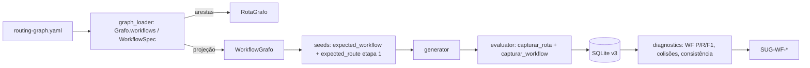

# Blueprint — Diagnóstico de Gatilhos de Workflows no CLI `synth` (rev. 2)

## 0. Changelog rev. 2 (achados @plan-critic rodada 1)
| Achado | Severidade | Resolução |
|---|---|---|
| 1 Nomes de tabelas | BLOCKER | DDL usa `synth_prompts` / `synth_evaluations` / `schema_meta` |
| 2 Migração v3 | BLOCKER | Novo ramo `v2→v3` em `migrar_conexao`; `SCHEMA_VERSION="3"`; `user_version=3` |
| 3 cli.py | MAJOR | Adicionado a `allowed_files` |
| 4 Regra de consistência | MAJOR | Matching com coringa `<stack>`, alternativas `|`, normalização `_normalizar_rota`, NULL para pré-etapas |
| 5 Regex/banner | MAJOR | `capturar_workflow()` separada; flags declaradas; ID validado contra snapshot (9 workflows) |
| 6 Riscos/rollback/testes | MAJOR | Seções 8 e 9 explícitas |
| 7 Glob de testes | MAJOR | Declarados como novos arquivos; diretório confirmado na B1 |
| 8 Duplicação de modelo | MINOR | VO do synth é projeção de `WorkflowSpec` |
| 9 CREATE TABLE no código | MINOR | DDL de workflows também em `storage.py` (padrão l.44/60) |
## 1. Diagnóstico de Cobertura Atual

`workflows:` em `.github/agents/routing-graph.yaml`: lista com `id`, `nome`, `regra`, `fast_path`, `gatilhos[]`, `estados[{etapa, nome, agents_permitidos[]}]`. O loader de domínio já expõe `Grafo.workflows: tuple[WorkflowSpec, ...]` (`routing/model.py:246`, `graph_loader._construir_workflows` l.241), mas o synth não os consome.

| Componente | Cobre hoje | NÃO cobre |
|---|---|---|
| synth/routing_graph.py | `_converter_grafo_para_snapshot` (l.175-225) usa só `grafo.nos`/`arestas` → `RotaGrafo` | `grafo.workflows` |
| seeds.py | `gerar_seeds_grafo` (off/gaps/all), `expected_route=rota.para` | seeds por gatilho de workflow, `expected_workflow` |
| evaluator.py | `capturar_rota` (l.66-86) via `_REGEX_BANNER` (`Delegado:`/`Agente Ativo:`) e tool `delegar`, `_normalizar_rota` (l.61) | linhas `Workflow:` / `Etapa do Workflow:` |
| diagnostics.py | `_detectar_colisoes_estaticas` entre keywords de arestas; gaps; SUG-* | colisões entre gatilhos de workflows, WF P/R/F1, consistência workflow×rota |
| storage.py / schema.sql | v2: `synth_prompts`, `synth_evaluations`, `routing_graph_edges`, `synth_diagnostics`, `schema_meta` | dimensão workflow |
| exporter.py | `expected: {agent_route}` | `expected.workflow` (casos-roteamento.yaml já usa `workflow:` em 7 casos) |

Conclusão: o synth atual não consegue aprimorar gatilhos de workflows.

## 2. Blueprint Técnico



### Decisão de Design Pattern (mini-ADR)
- Contexto: workflow é um eixo de classificação ortogonal à aresta; o modelo de domínio já existe em `WorkflowSpec`.
- Decisão: Projeção imutável (`WorkflowGrafo`) derivada de `WorkflowSpec`, sem redefinir o modelo; migração aditiva de schema.
- Alternativas: pipeline `synth-wf` paralelo (duplica gerador/orçamento); derivar workflow da rota (rota não determina workflow — tech-solution-architect aparece em vários); redefinir modelo próprio (duplicação, deriva com o loader).
- Consequências: +1 dimensão de métricas; acoplamento ao `routing/model.py` (já existente para arestas).
## 3. Contratos de Dados (Spec-First)

### 3.1 Projeção (routing_graph.py)
- **Extensão do modelo de domínio (routing/)**:  (routing/model.py l.219-224) ganha  e .  (l.241) lê  (lista de str, default , erro explícito se não for lista de str) e  (bool, default False). Não confundir com  das arestas (l.181).
- `WorkflowGrafo(frozen)` construído de `WorkflowSpec`: `workflow_id`, `nome`, `fast_path`, `gatilhos_norm: tuple[str,...]` (via `normalizar`), `etapa1_padroes: tuple[str,...]`, `workflow_hash` (sha256 de `_canonical_json`).
- `etapa1_padroes`: tokens de `agents_permitidos` da etapa 1, separados por `|`, `strip()` + `_normalizar_rota`; `<stack>` vira coringa (`<stack>-developer` → padrão `*-developer`); `domain-router` vira padrão `*-router`.
- `GrafoSnapshot.workflows: tuple[WorkflowGrafo,...] = ()` (default vazio = compat).
- Campo exato de gatilhos em `WorkflowSpec` confirmado na B1 (UNKNOWN na revisão).

### 3.2 SQLite v2 → v3 (aditivo)
Em `storage.py`:
- `SCHEMA_VERSION = "3"`; comentário de `schema.sql` atualizado para v3.
- `migrar_conexao`: casos (a) banco novo → cria tudo e grava `user_version=3`, `schema_version='3'`; (b) v1 → fluxo atual até v2, depois aplica v3; (c) `user_version == 2` → aplica ramo v3; (d) `user_version >= 3` → retorno idempotente.
- ALTERs idempotentes via `_colunas_tabela` (l.105), antes dos índices:
```sql
-- executados individualmente somente se a coluna não existir
ALTER TABLE synth_prompts ADD COLUMN expected_workflow TEXT;     -- NULL = seed legado
ALTER TABLE synth_prompts ADD COLUMN graph_workflow_id TEXT;
ALTER TABLE synth_evaluations ADD COLUMN observed_workflow TEXT;
ALTER TABLE synth_evaluations ADD COLUMN observed_etapa INTEGER;
ALTER TABLE synth_evaluations ADD COLUMN workflow_source TEXT;    -- text_banner | none
ALTER TABLE synth_evaluations ADD COLUMN workflow_route_consistent INTEGER; -- 1/0/NULL

CREATE TABLE IF NOT EXISTS routing_graph_workflows (
  workflow_id TEXT NOT NULL,
  graph_sha256 TEXT NOT NULL,
  nome TEXT NOT NULL,
  fast_path INTEGER NOT NULL DEFAULT 0,
  gatilhos_json TEXT NOT NULL,
  etapa1_padroes_json TEXT NOT NULL,
  workflow_hash TEXT NOT NULL,
  PRIMARY KEY (workflow_id, graph_sha256)
);
CREATE INDEX IF NOT EXISTS ix_synth_prompts_graph_workflow ON synth_prompts(graph_workflow_id);
PRAGMA user_version = 3;
UPDATE schema_meta SET value = '3' WHERE key = 'schema_version';
```
- `CREATE TABLE routing_graph_workflows` definido também como constante DDL em `storage.py` (mesmo padrão de `routing_graph_edges` l.44 e `synth_diagnostics` l.60) e espelhado em `schema.sql`.
- `registrar_workflows_grafo(snapshot)` chamado em `executar_synth_diagnose` ao lado de `registrar_arestas_grafo` (use_cases.py l.345).

### 3.3 Export silver (exporter.py)
`expected: {agent_route, workflow?}`; `observed: {observed_route, observed_workflow?}`; campos omitidos quando NULL.

### 3.4 Extração (evaluator.py)
- Nova função `capturar_workflow(texto, ids_validos) -> tuple[str | None, int | None, str]`, separada; `capturar_rota` e `route_source` permanecem inalterados.
- Regex: `^\s*(?i:workflow)\s*:\s*(WORKFLOW-[A-Z]+(?:-[A-Z]+)*|N/A)\s*$` com `re.MULTILINE` (rótulo case-insensitive, ID case-sensitive).
- Etapa: `^\s*(?i:etapa do workflow)\s*:\s*(\d+)` com `re.MULTILINE`.
- `N/A` → None; ID fora de `ids_validos` (os 9 do snapshot) → None + `workflow_source="invalid_id"` (alimenta SUG-WF-UNKNOWN-ID). Nunca inventa workflow.
- `detectar_override`/`sanitizar_prompt` passam a rejeitar `Workflow:` e `Etapa do Workflow:` em prompts.

### 3.5 Regra de consistência

Ordem importa: PROMPT-SYNTHESIS (etapa 1 ) e FEATURE-DEVELOPMENT () casam como 1;  vira NULL em qualquer workflow.```
PRE_ETAPAS = {binding-initializer, prompt-structuring}
se observed_workflow é None ou observed_route é None        → NULL
se observed_route ∈ PRE_ETAPAS e workflow ≠ FEATURE-DEVELOPMENT → NULL (pré-etapa legítima)
se observed_route casa algum padrão de etapa1_padroes (fnmatch) → 1
senão                                                          → 0
```
## 4. Métricas e Sugestões (diagnostics.py)
- Por workflow: precision/recall/F1; macro-F1; accuracy; `workflow_route_consistency_rate` (só sobre não-NULL); matriz de confusão workflow×workflow; `banner_coverage` (% com `Workflow:` válido).
- Colisões: `_detectar_colisoes_estaticas` genericizado para gatilhos de workflows distintos (exata/substring) e cruzado gatilho×keyword de aresta cujo `para` não casa `etapa1_padroes`.
- Sugestões determinísticas (ordenação estável):
  - `SUG-WF-COLLISION`, `SUG-WF-LOW-RECALL`, `SUG-WF-LOW-PRECISION`, `SUG-WF-INCONSISTENT-ROUTE`, `SUG-WF-MISSING-BANNER`, `SUG-WF-UNKNOWN-ID`, `SUG-WF-UNCOVERABLE`.
- `diagnostic_exporter.py`: seção "Workflows"; `RelatorioSynth` ganha `n_colisoes_workflow`, `workflow_macro_f1`, `workflow_route_consistency_rate`.

## 5. Alternativas Rejeitadas
- LLM-as-judge para workflow: não determinístico e caro; banner é contrato estável.
- Edição automática de `routing-graph.yaml`: viola HITL; synth só sugere.
- Recriar DB: perde histórico silver.
- Alterar o banner do agent-router neste plano: fora do escopo (governança); a regex aceita os 9 IDs e `N/A`. Registrar como follow-up para `@governance-maintainer` (banner l.302 lista 8 IDs e não lista `N/A`).

## 6. 🛡️ Modelagem de Ameaças & Requisitos de Segurança (Shift-Left)
- Tampering/Prompt Injection: rejeitar `Workflow:`/`Etapa do Workflow:` em prompts sintéticos.
- Spoofing de ID: validação contra `ids_validos` do snapshot.
- Repudiation: `workflow_hash` + `graph_sha256` por avaliação.
- DoS de orçamento: seeds de workflow no mesmo `validar_orcamento_synth`, teto por workflow.
- Path traversal: exports sob `_validar_sob_root`. Sem PII.

## 7. Context Firewall — Divisão de Tarefas

### [BACKEND_TASKS]
**B1 — Projeção + persistência** — `@python-developer` (via agent-router)
1. Confirmar diretório real de testes e campo de gatilhos em `WorkflowSpec`; atualizar `allowed_files`.
2. `WorkflowGrafo` + `_projetar_workflows(grafo)`; `GrafoSnapshot.workflows`.
3. Migração v3 em `storage.py`/`schema.sql` (casos a–d); `registrar_workflows_grafo`; chamada em `use_cases.executar_synth_diagnose`.

**B2 — Seeding + extração + CLI** — `@python-developer`
1. `gerar_seeds_workflows(snapshot, modo)`: 1 seed por gatilho (`expected_workflow`; `expected_route` = 1º padrão concreto da etapa 1, ou NULL se só coringa) + seeds de fronteira para pares colidentes.
2. `cli.py`: `--workflow-seeds off|gaps|all` (default `off`) ao lado de `--graph-seeding` (l.100-101) e dispatch (l.190-250).
3. `capturar_workflow()` + regra 3.5 + extensão de `detectar_override`.
4. `exporter.py`: campos opcionais.

**B3 — Diagnóstico + relatório** — `@python-developer`
1. Métricas da seção 4; colisões; `SUG-WF-*`.
2. `diagnostic_exporter.py` + `RelatorioSynth`.

### [FRONTEND_TASKS]
- N/A (CLI sem UI).

## 8. Riscos e Rollback
| Risco | Classe | Mitigação |
|---|---|---|
| Banco v2 existente | COMPATIBLE | Ramo v2→v3 aditivo e idempotente |
| Leitor v2 abrindo banco v3 | COMPATIBLE | Colunas extras ignoradas; tabela nova não lida |
| Respostas sem `Workflow:` | COMPATIBLE | NULL + SUG-WF-MISSING-BANNER, nunca falha |
| Coringa `<stack>` gerando falso positivo | Médio | Padrões ancorados (`*-developer`), testes de tabela |
| Banner com 8 IDs | Baixo | Validação por snapshot; follow-up de governança |
| Mudança em modelo compartilhado  | COMPATIBLE | Campos com default; suíte  existente deve passar sem alteração |

Rollback: reverter o código. SQLite não faz `DROP COLUMN` com segurança, então as colunas v3 permanecem inertes. Para voltar a `user_version=2`, usar backup do `.db` feito antes da migração (`<db>.bak-v2`, criado pelo ramo (c) do §3.2).

## 9. Critérios de Teste (gate de cada fase)
- B1: banco novo nasce v3; banco v2 fixture migra sem perda de linhas; v3 reaberto é no-op; snapshot real tem `len(workflows) == 9` e etapa 1 não vazia; hash estável.
- B2: tabela de casos de `capturar_workflow` (ID válido, `N/A`, ID inválido, rótulo minúsculo, ausente); regra 3.5 com `<stack>-developer`, `domain-router`, `prompt-structuring` em fast-path (NULL) e em FEATURE-DEVELOPMENT (1), BUG-FIX→feature-planner (0); `--workflow-seeds off` produz saída byte-idêntica à v2.
- B3: golden do relatório; métricas de arestas inalteradas (regressão); ordem de `SUG-WF-*` determinística.
- Cobertura: ≥ 90% de linhas nos módulos alterados.
